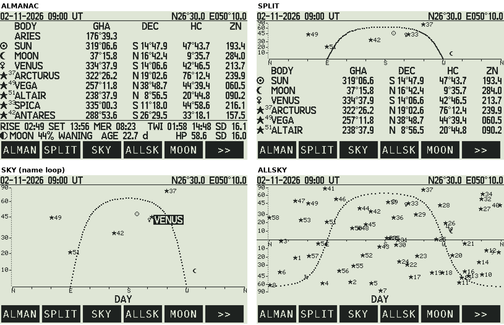
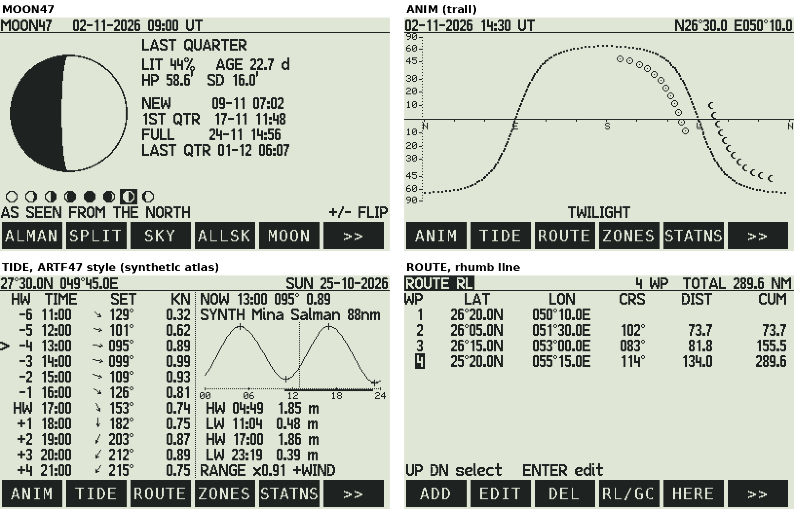
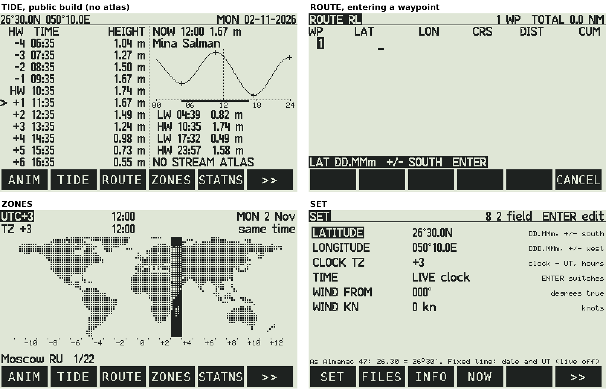

# NAV47 — Almanac 47 + Zones 47 + Tide 47 for the DM42n

**NAV47.pg5** is a native DMCP5 program in C for the SwissMicros **DM42n**. It joins three of the "47"
projects into one navigation computer:

No start menu: it opens on ALMANAC, and the **soft-key bar** (F1-F6, `>>` for the next row, as Chess 47) goes
everywhere.

| Keys | Page | From | What it shows |
|---|---|---|---|
| F1 | **ALMAN** | [almanac47](https://github.com/valdesvj/almanac47) | ARIES, the 8 bodies (Sun, Moon, a planet, the brightest stars): GHA, Dec, Hc, Zn; rise/set, twilight, meridian passage, SD, the Moon's phase and age |
| F2 | **SPLIT** | almanac47 | the horizon chart with the celestial equator above the table: 6 bodies at a time, **8 2** scroll (the small arrows by BODY show more above / below) |
| F3 | **SKY** | almanac47 | the horizon chart, sine scale, celestial equator; the names of the bodies in turn, one a second |
| F4 | **ALLSK** | almanac47 | the whole sky: all 58 stars, planets, Moon, Sun, above and below the horizon |
| F5 | **MOON** | almanac47 (MOON47) | the disc, phase, % lit, age, HP, SD, the next four phases, the eight phases; **0** the view from the south |
| `>>` F1 | **ANIM** | almanac47 | the movie: the Sun and the Moon across the whole sky, 24 frames 30 min apart |
| `>>` F2 | **T&F** | [tide47](https://github.com/valdesvj/tide47) (ARTF47) | tide and current on one page, as ARTF47: HW−6 … HW+6 with the stream of the FLOW atlas at your position (set, knots, arrow), and the tide of the nearest port (curve, high and low waters). Without an atlas: the chosen station's heights or stream |
| `>>` F3 | **TIDE** | tide47 | the chosen station's day: curve, high and low waters (or slack, flood, ebb), now, the range against springs, the next springs and neaps; **8 2** the previous / next station, **4 6** the day, **ENTER** the station list |
| `>>` F4 | **ROUTE** | | passage planning: waypoints, course and distance of each leg, the cumulative distance; rhumb line or great circle |
| `>>` F5 | **ZONES** | [zones47](https://github.com/valdesvj/zones47) | the world map with the zone column, its time and date, DST computed on the calculator, the cities |
| `>> >>` | **SET FILES INFO NOW USB** | | position, clock TZ, live or fixed time, wind; tide files; about; back to now; the screen to the PC |

The views are Almanac 47's (`python/native/c47screen21.py`): the same bodies, charts, glyphs47 symbols (☉ ☾ ♀ ♂ ♃ ♄
★ and the Moon phases), tinyFont scale labels and dotted celestial equator, in the 208 rows above the menu bar. The
text is in Almanac 47's **C47 standard font** (GRFNT 21) on 16-pixel rows, drawn pixel for pixel by NAV47 (what the
simulator shows is what the DM42n shows); the DMCP system font is kept for the menu bar. On the DM42n a view takes
about 0.1 s (battery).







*(Simulator pictures; the menu bar's font stands in for the DMCP one. The TIDE page with streams uses Tide 47's
synthetic atlas: the real atlas is private.)*

## ROUTE: passage planning

**ADD** a waypoint after the cursor (then type LAT `DD.MMm` ENTER, LON `DDD.MMm` ENTER, **+/−** for S and W),
**HERE** adds the position of SET, **EDIT** (or ENTER) changes it, **DEL** removes it, **UP DOWN** move.
Each row shows the leg from the waypoint before: **CRS** (true), **DIST** and **CUM** (nm), the total on top.

* **RL**, rhumb line: Mercator sailing with the meridional parts of the WGS84 spheroid (Bowditch:
  MP = 7915.7045 log tan(45° + φ/2) − 23.0133 sin φ − 0.0514 sin³ φ), parallel sailing on an east-west leg, the
  shorter way across 180°.
* **GC**, great circle: the distance on the sphere (1′ = 1 nm) and the **initial** course (ICRS).

The route is saved in `/NAV47/ROUTE.TXT` (one `lat lon` per line, degrees), up to 40 waypoints.

## The screen on your PC (USB)

**`>> >>` USB** (it shows `USB*` while on) turns the USB port into a serial port (`/dev/ttyACM0`) and sends every new
screen to the PC: the LCD as text (`NAV47 LCD 400 240`, 240 lines of 100 hex digits, `END`).

The firmware's own `usb_acm_on()` leaves the port disconnected (USB47's register probe: `DCTL.SDIS` stays 1), so NAV47
drives the USB itself with **TinyUSB** (`src/usb/`, `third_party/tinyusb`, MIT): the USB supply and 48 MHz clock, its
own interrupt handler in a RAM copy of the vector table, one CDC serial port. While USB is on the calculator does not
sleep (it would stop the USB); press USB again to stop and give the port back to the firmware (the USB disk). NAV47
learns how the firmware stores the LCD lines (it sets a pixel and looks which bit changes).

```bash
python3 tools/dm42view.py                      # the screen in the terminal (Braille dots), new at every key
python3 tools/dm42view.py --zoom 200,16,200,160 # a part, bigger: the small letters readable
python3 tools/dm42view.py --png shots/          # and a PNG of every screen (Pillow)
```

On Linux the port is `/dev/ttyACM0`; your user needs the `uucp` group (Arch) or `dialout` (Debian).

## Same precision as Almanac 47

* The astronomy (`src/astro.c`) is the C twin of Almanac 47's `python/native/c47astro.py`, step for step, in double
  precision: VSOP87D Sun and planets, IAU1980 nutation, the Meeus Moon with the DE421 correction terms, the 58 stars
  with IAU2006 precession, aberration and nutation.
* **The full NAVINIT is compiled in.** `src/almdata.c` holds all 4,344 coefficients of NAVINIT_FULL
  (MATA MATST MATM MATP), bit for bit from `c47data.py`. That's 35 KB of the DM42n's 1 MB of program flash,
  with nothing to initialize and no RAM used. No TBL tables are needed: the DM42n computes the series directly.
* `test/test_astro.py` compares every result with the Python twin (302 dates × 71 results): the Moon, the Sun
  events and the phase are bit-identical, everything else within 1×10⁻¹¹°.
* Tides: `src/tide.c` is the twin of Tide 47's exact engine, `python/tide47ref.py` `day_exact` / `sday_exact` (`test/test_tide.py`: 478 checks within
  10⁻¹⁴). Zones: the DST rules agree with the IANA database at every change of 2026, 2027 and 2030
  (`test/test_zones.py`).

## Install on the DM42n

1. **Back up the calculator disk**, then copy `NAV47.pg5` (from `make`, or the GitHub release) to it. Also keep `DM42-x.yy.pg5` on the disk to go back
   to Free42.
2. Press **RESET while holding F1** to open the DMCP menu, then **Load program → NAV47.pg5**.
3. **SET** (key `>>`, then SET): your position in DD.MMm (as Almanac 47: `26.30` = 26°30′, **+/−** for south / west)
   and **CLOCK TZ**: how far the calculator clock is from UT (+3 for a clock on Gulf time).
4. **SHOW TIMES**: UT or LOCAL (LT). Switch it any time with **+/−** on any page.

To go back to Free42: **RESET + F1 → Load program → DM42-x.yy.pg5**.

## Keys

| Key | Action |
|---|---|
| **F1-F6** | the soft keys; `>>` the next row (ALMAN SPLIT SKY ALLSK MOON / ANIM T&F TIDE ROUTE ZONES / SET FILES INFO NOW USB) |
| **UP DOWN** | views: one hour later / earlier (as Almanac 47). ZONES: the cities. SET / STATNS / ROUTE: move |
| **4 6 / 7 9** | views: 10 minutes / one day. ZONES: zone west / east. TIDE: High Water before / after |
| **1 3** | TIDE: day before / after |
| **5** | back to now (ZONES: the zone of your clock) |
| **+/−** | every page: the times in UT or local time (LT), saved. Entering a position: south / west |
| **0** | MOON: the view from the south |
| **ENTER** | TIDE: the station list. SET, ROUTE: edit (ENTER again to confirm, EXIT or CANCEL to cancel) |
| **EXIT** | back to ALMANAC |
| **SHIFT EXIT** | power off (settings saved to `/NAV47/NAV47.CFG`) |
| **SHIFT 0** | setup: time, date, beep, USB disk, System |

**Time:** LIVE uses the calculator clock minus CLOCK TZ. FIXED (SET → TIME) uses a date and UT you enter, for
planning or for checking against the Nautical Almanac.

**UT or LT:** SET → SHOW TIMES, or **+/−** on any page, shows every time in UT or in local time. The header says which
(`UT` / `LT`). Local is the CLOCK TZ on the views (ALMANAC, SPLIT, SKY, ALLSKY, ANIM, MOON47: rise, set, meridian
passage and twilights are then those of your local day), on T&F and on ZONES; TIDE keeps the station's own zone, as a
tide table does (`UTC+3`), and in UT shows `UT (day UTC+3)`: the same station day, its times and hour axis in UT.

## Private data: Aramco tables, Admiralty constants, GEOSA streams, the FLOW atlas

Nothing private is in this repository. You have two ways to get your private data onto your own calculator:

**A. Compiled into your own `.pg5`.** Point the build at your local Tide 47 checkout:

```bash
make TIDE47=~/opt/tide47
```

The build reads `python/stations_private.py`, `streams_private.py` and `flow_private.py` (the git-ignored files that
Tide 47's `make_private*.py` and `make_flow.py` write) into `build/gen/tidedata_priv.c`. They appear first in the
station list as PRIVATE, and TIDE uses the atlas with its reference station (Ras Tanura). `build/` is ignored
by git. **Keep that `.pg5` to yourself.** A plain `make` builds the public version.

**B. As files, loaded in the FILES menu.** Write them on your computer and copy them to `/NAV47/TIDES/` on the
calculator:

```bash
python3 tools/gen_tides.py files ~/opt/tide47 /path/to/DM42n/NAV47/TIDES --private-only
```

That writes one `.TID` file per region (stations: tides and streams) and `FLOW.FLW` (the atlas). On the
DM42n: **>> >> → FILES → TID** (or **FLW**) and choose the file. Loaded files are remembered and reloaded at start;
CLEAR forgets them. The format is plain text (see `src/tidefile.c`), so you can also write a station by hand.

## Build

```bash
sudo pacman -S arm-none-eabi-gcc arm-none-eabi-newlib make python      # Arch (Debian: gcc-arm-none-eabi)
make                       # build/NAV47.pg5  (public data)
make TIDE47=~/opt/tide47   # + your private data
make test ALMANAC47=~/almanac47 ZONES47=~/zones47 TIDE47_TEST=~/opt/tide47   # the C engines vs the Python twins
make data  ...             # regenerate src/ data from the 47 repositories (same paths)
make sim                   # PC simulator: build/sim, pictures with test/sim/render.py
```

## Inside

| | |
|---|---|
| `src/astro.c` `almdata.c` | Almanac 47's astronomy and its NAVINIT_FULL series (`tools/gen_almanac.py`) |
| `src/zones.c` `zonedata.c` | Zones 47: 38 zones, 311 cities, tzdata 2026e, the dot map (`tools/gen_zones.py`) |
| `src/tide.c` `tidecons.c` `tidedata_pub.c` | Tide 47's engine, its 60 constituents, 32 public stations (`tools/gen_tides.py`) |
| `src/tidefile.c` | the `.TID` / `.FLW` file reader |
| `src/views.c` `c47scr.c` `fonts21.c` | Almanac 47's views on a C47 screen layer (PIXEL, AGRAPH), glyphs47 symbols and tinyFont (`tools/gen_fonts21.py`) |
| `src/ntext.c` | the page text in the C47 standard font on 16-pixel rows; the degree sign |
| `src/moon47.c` | MOON47, the C twin of Almanac 47's `python/moon47.py` (`test/test_moon47.py`: 400 dates, identical) |
| `src/route.c` | ROUTE: rhumb line and great circle |
| `src/usbview.c`, `tools/dm42view.py` | the screen to the PC over USB, and its terminal viewer |
| `src/gfx.c` `fonts.c` | the other pages, C47 standardFont and tinyFont (`tools/gen_fonts.py`) |
| `src/main.c` | the pages, keys, settings |
| memory | 262 KB of program flash. Static RAM 1.7 KB of 8 KB; the rest is on the heap |

## Data and credits

* Astronomy: VSOP87 (Bretagnon & Francou), IAU1980 nutation, Meeus *Astronomical Algorithms*, JPL DE421 fit, as in Almanac 47.
* Time zones: the IANA tz database (public domain). Map land mask: GLOBE / NOAA (global-land-mask).
* Tides: NOAA CO-OPS harmonic constants (public domain); TICON-3 (CC-BY 4.0, Piccioni et al.).
* Fonts: the C47 standardFont and tinyFont, (c) the C43/C47 authors, GPL v3.
* `dmcp/`, `stm32_program.ld`: SwissMicros DMCP5 SDK (BSD-3, "NOMAS": not manufacturer supported).

Written with the help of AI. I review and check the results and take responsibility for this project and its
mistakes. See `AI_ASSISTANCE.md` for the responsible-use statement.

**DOES NOT REPLACE THE NAUTICAL ALMANAC OR OFFICIAL TIDE TABLES. Not for use as the primary means of navigation.**

GPL-3.0-or-later © 2026 Victor Valdes.
