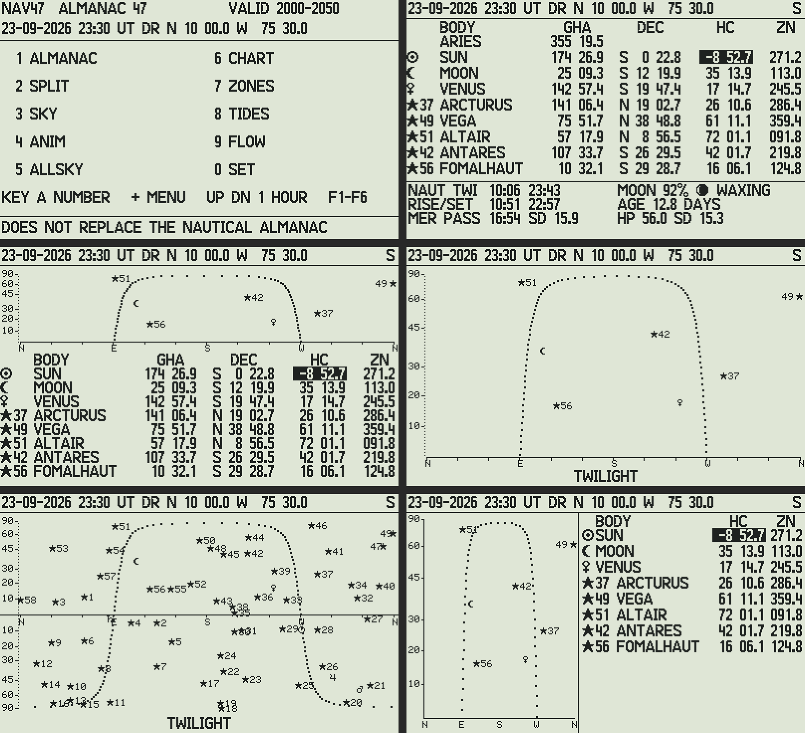
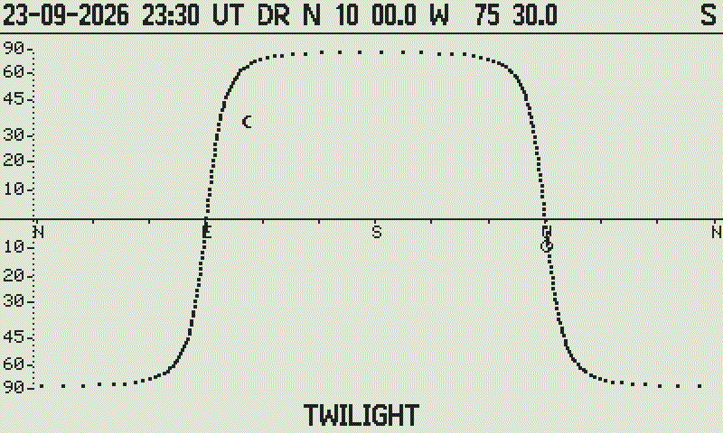
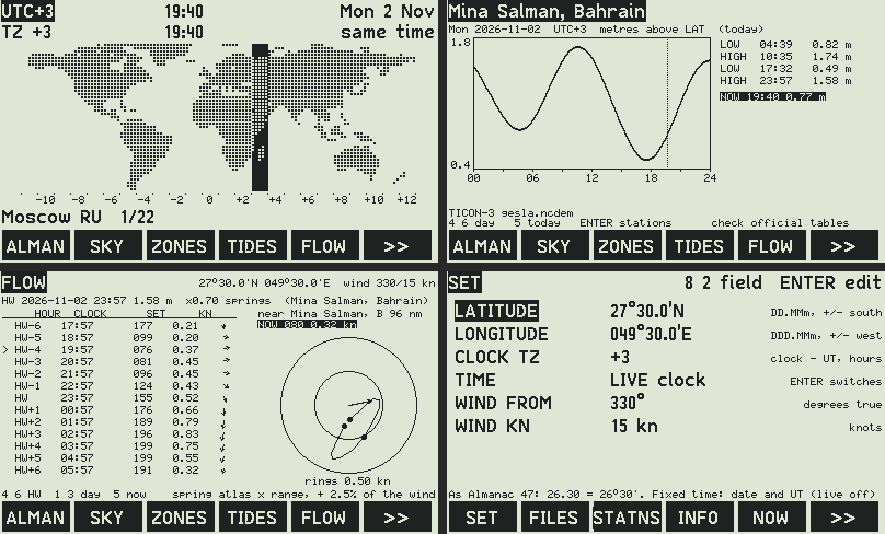

# NAV47 — Almanac 47 + Zones 47 + Tide 47 for the DM42n

**NAV47.pg5** is a native DMCP5 program in C for the SwissMicros **DM42n**. It joins three of the "47"
projects into one navigation computer:

It starts on the Almanac 47 menu: **key a number**.

| Key | View | From | What it shows |
|---|---|---|---|
| **1** | **ALMANAC** | [almanac47](https://github.com/valdesvj/almanac47) | ARIES, the 8 bodies (Sun, Moon, a planet, the brightest stars): GHA, Dec, Hc, Zn; twilight, rise/set, meridian passage, Moon phase |
| **2** | **SPLIT** | almanac47 | the horizon chart with the celestial equator above the almanac table |
| **3** | **SKY** | almanac47 | the horizon chart, sine scale, celestial equator; the names of the bodies in turn, one a second |
| **4** | **ANIM** | almanac47 | the movie: the Sun and the Moon across the whole sky, 24 frames 30 min apart |
| **5** | **ALLSKY** | almanac47 | the whole sky: all 58 stars, planets, Moon, Sun, above and below the horizon |
| **6** | **CHART** | almanac47 | the narrow chart with the Hc / Zn list |
| **7** | **ZONES** | [zones47](https://github.com/valdesvj/zones47) | the world map with the zone column, its time and date, DST computed on the calculator, the cities |
| **8** | **TIDES** | [tide47](https://github.com/valdesvj/tide47) | the day's curve, high and low waters (or slack / max for streams, rotary too), the value now |
| **9** | **FLOW** | tide47 (FLOW47, ARTF47) | the tidal stream atlas at your position: HW-6...HW+6 table, rose, the stream now, the nearest port |
| **0** | **SET** | | position, clock TZ, live or fixed time, wind |

Views 1-6 are Almanac 47's C47 views, ported line for line from `python/native/c47screen21.py` with the same fonts
(GRFNT 21, tinyFont) and glyphs47 symbols: **`test/test_views.py` checks 240 screens against the Python, pixel for
pixel (all identical)**. On the DM42n a view takes about 0.1 s (battery) instead of the C47's ten seconds.







*(Simulator pictures. Zones, Tides and FLOW below; FLOW uses Tide 47's synthetic atlas: the real atlas is private.)*

## Same precision as Almanac 47

* The astronomy (`src/astro.c`) is the C twin of Almanac 47's `python/native/c47astro.py`, step for step, in double
  precision: VSOP87D Sun and planets, IAU1980 nutation, the Meeus Moon with the DE421 correction terms, the 58 stars
  with IAU2006 precession, aberration and nutation.
* **The full NAVINIT is compiled in.** `src/almdata.c` holds all 4,344 coefficients of NAVINIT_FULL
  (MATA MATST MATM MATP), bit for bit from `c47data.py`. That's 35 KB of the DM42n's 1 MB of program flash,
  with nothing to initialize and no RAM used. No TBL tables are needed: the DM42n computes the series directly.
* `test/test_astro.py` compares every result with the Python twin (302 dates × 71 results): the Moon, the Sun
  events and the phase are bit-identical, everything else within 1×10⁻¹¹°.
* Tides: `src/tide.c` is the twin of Tide 47's `python/tide47ref.py` (`test/test_tide.py`: 478 checks within
  10⁻¹⁴). Zones: the DST rules agree with the IANA database at every change of 2026, 2027 and 2030
  (`test/test_zones.py`).

## Install on the DM42n

1. **Back up the calculator disk**, then copy `NAV47.pg5` (from `make`, or the GitHub release) to it. Also keep `DM42-x.yy.pg5` on the disk to go back
   to Free42.
2. Press **RESET while holding F1** to open the DMCP menu, then **Load program → NAV47.pg5**.
3. **SET** (key `>>`, then SET): your position in DD.MMm (as Almanac 47: `26.30` = 26°30′, **+/−** for south / west)
   and **CLOCK TZ**: how far the calculator clock is from UT (+3 for a clock on Gulf time).

To go back to Free42: **RESET + F1 → Load program → DM42-x.yy.pg5**.

## Keys

| Key | Action |
|---|---|
| **0-9** | on the menu: the views and pages |
| **+** or **EXIT** | back to the menu |
| **UP DOWN** | views: one hour later / earlier (as Almanac 47). ZONES: the cities. SET / STATIONS: move |
| **4 6 / 7 9** | views: 10 minutes / one day. ZONES: zone west / east. TIDES: day before / after. FLOW: High Water before / after |
| **5** | back to now (ZONES: the zone of your clock) |
| **ENTER** | TIDES: the station list. SET: edit the field (ENTER again to confirm, EXIT to cancel) |
| **1 3** | FLOW: day before / after |
| **F1-F6** | MENU ZONES TIDES FLOW STATNS, `>>`: SET FILES INFO NOW ANIM |
| **SHIFT EXIT** | power off (settings saved to `/NAV47/NAV47.CFG`) |
| **SHIFT 0** | setup: time, date, beep, USB disk, System |

**Time:** LIVE uses the calculator clock minus CLOCK TZ. FIXED (SET → TIME) uses a date and UT you enter, for
planning or for checking against the Nautical Almanac.

## Private data: Aramco tables, Admiralty constants, GEOSA streams, the FLOW atlas

Nothing private is in this repository. You have two ways to get your private data onto your own calculator:

**A. Compiled into your own `.pg5`.** Point the build at your local Tide 47 checkout:

```bash
make TIDE47=~/opt/tide47
```

The build reads `python/stations_private.py`, `streams_private.py` and `flow_private.py` (the git-ignored files that
Tide 47's `make_private*.py` and `make_flow.py` write) into `build/gen/tidedata_priv.c`. They appear first in the
station list as PRIVATE, and FLOW uses the atlas with its reference station (Ras Tanura). `build/` is ignored
by git. **Keep that `.pg5` to yourself.** A plain `make` builds the public version.

**B. As files, loaded in the FILES menu.** Write them on your computer and copy them to `/NAV47/TIDES/` on the
calculator:

```bash
python3 tools/gen_tides.py files ~/opt/tide47 /path/to/DM42n/NAV47/TIDES --private-only
```

That writes one `.TID` file per region (stations: tides and streams) and `FLOW.FLW` (the atlas). On the
DM42n: **>> → FILES → TID** (or **FLW**) and choose the file. Loaded files are remembered and reloaded at start;
CLEAR forgets them. The format is plain text (see `src/tidefile.c`), so you can also write a station by hand.

## Build

```bash
sudo pacman -S arm-none-eabi-gcc arm-none-eabi-newlib make python      # Arch (Debian: gcc-arm-none-eabi)
make                       # build/NAV47.pg5  (public data)
make TIDE47=~/opt/tide47   # + your private data
make test ALMANAC47=~/almanac47 ZONES47=~/zones47 TIDE47_TEST=~/opt/tide47   # the C engines vs the Python twins
make data  ...             # regenerate src/ data from the 47 repositories (same paths)
make sim                   # PC simulator: build/sim, pictures with test/sim/render.py
```

## Inside

| | |
|---|---|
| `src/astro.c` `almdata.c` | Almanac 47's astronomy and its NAVINIT_FULL series (`tools/gen_almanac.py`) |
| `src/zones.c` `zonedata.c` | Zones 47: 38 zones, 311 cities, tzdata 2026e, the dot map (`tools/gen_zones.py`) |
| `src/tide.c` `tidecons.c` `tidedata_pub.c` | Tide 47's engine, its 60 constituents, 32 public stations (`tools/gen_tides.py`) |
| `src/tidefile.c` | the `.TID` / `.FLW` file reader |
| `src/views.c` `c47scr.c` `fonts21.c` | Almanac 47's C47 views and screen (PIXEL, AGRAPH, number printers), GRFNT 21 + glyphs47 (`tools/gen_fonts21.py`) |
| `src/gfx.c` `fonts.c` | the other pages, C47 standardFont and tinyFont (`tools/gen_fonts.py`) |
| `src/main.c` | the pages, keys, settings |
| memory | 266 KB of program flash. Static RAM 1.6 KB of 8 KB; the rest is on the heap |

## Data and credits

* Astronomy: VSOP87 (Bretagnon & Francou), IAU1980 nutation, Meeus *Astronomical Algorithms*, JPL DE421 fit, as in Almanac 47.
* Time zones: the IANA tz database (public domain). Map land mask: GLOBE / NOAA (global-land-mask).
* Tides: NOAA CO-OPS harmonic constants (public domain); TICON-3 (CC-BY 4.0, Piccioni et al.).
* Fonts: the C47 standardFont and tinyFont, (c) the C43/C47 authors, GPL v3.
* `dmcp/`, `stm32_program.ld`: SwissMicros DMCP5 SDK (BSD-3, "NOMAS": not manufacturer supported).

Written with the help of AI (Claude by Anthropic). I review and check the results and take responsibility for
this project and its mistakes.

**DOES NOT REPLACE THE NAUTICAL ALMANAC OR OFFICIAL TIDE TABLES. Not for use as the primary means of navigation.**

GPL-3.0-or-later © 2026 Victor Valdes.
