# 1. The calculator

NAV47 runs on the SwissMicros **DM42n** (DMCP5). This manual covers installing it, the keys, and every page.
The GPS pages have their own manual: [2. The GPS](02-gps.md).

- [Install](#install)
- [The keys](#the-keys)
- [The almanac views](#the-almanac-views): ALMANAC, SPLIT, SKY, ALL SKY, MOON, ANIM
- [Tides and streams](#tides-and-streams): T&F, TIDE
- [Passage planning](#passage-planning): ROUTE, WPTS, PLAN, CHART, VOYAGE, ETA
- [ZONES](#zones)
- [SET, FILES, INFO, USB](#set-files-info-usb)
- [DP OPS and ABS SKP](#dp-ops-and-abs-skp)
- [Your files](#your-files)

---

## Install

1. **Back up the calculator's disk.** Connect it by USB (SHIFT 0 → USB disk) and copy everything to your computer.
2. Copy `NAV47.pg5` to the calculator's disk. Keep `DM42-x.yy.pg5` (Free42) there too, to go back.
   - `build/NAV47.pg5` needs DMCP5 **3.58** or later (it uses DMCP's own serial console).
   - `build/tinyusb/NAV47.pg5` works with **any** DMCP5 (NAV47 runs the USB itself).
3. Press **RESET while holding F1** → **Load program** → `NAV47.pg5`.
4. Open **SET** (`>>` `>>` then SET) and enter:
   - **LATITUDE** and **LONGITUDE** in DD.MMm (`26.30` = 26°30′), **+/−** for south or west;
   - **CLOCK TZ**: the calculator clock minus UT, in hours (`+3` for a clock on Gulf time).

To go back to Free42: **RESET + F1** → **Load program** → `DM42-x.yy.pg5`.

## The keys

The soft keys **F1–F6** follow the menu at the bottom of the screen. **`>>`** shows the next row:

| Row | F1 | F2 | F3 | F4 | F5 |
|---|---|---|---|---|---|
| 1 | ALMAN | SPLIT | SKY | ALLSK | MOON |
| 2 | ANIM | T&F | TIDE | ROUTE | ZONES |
| 3 | SET | FILES | INFO | DP | USB |
| 4 | FIX | SATS | NAV | BOW | GPSSET |
| 5 | WPTS | LOAD | SAVE | NEW | COMPAS |

On ROUTE another row edits the route: ADD, EDIT, DEL, RL/GC, HERE.

Row 5, your routes (`/NAV47/ROUTES/`): **WPTS** your waypoints' list; **LOAD** a route from the list of files (it
becomes the route, `/NAV47/ROUTE.TXT`); **SAVE** the route by name (up to 8 letters, digits, `-`, typed as in WPTS:
F1–F6 a group, then the letter; ENTER; an existing file asks before it is replaced): `/NAV47/ROUTES/NAME.TXT`;
**NEW** an empty route (ENTER yes, EXIT no). The route's name shows in ROUTE's top bar; the web page's routes carry
theirs (`NAME` in ROUTE.TXT).

| Key | Everywhere |
|---|---|
| **+/−** | all times in UT or local time (LT); saved |
| **EXIT** | back (to ALMANAC from a main page) |
| **SHIFT EXIT** | power off; the settings are saved in `/NAV47/NAV47.CFG` |
| **SHIFT 0** | DMCP setup: time, date, beep, USB disk, system |

**The top bar** on every page: the date and time (LT or UT) on the left, the page's name in the middle, the position
on the right. The position is SET's, the one every page computes with. While the GPS runs a small tag goes before
it: **GPS**, **DGPS**, **DR**… when SET follows the GPS (GPSSET → SET FOLLOWS), **SET** when it does not. On the GPS
pages the bar shows the vessel's own position, every second ([2. The GPS](02-gps.md#the-gps-pages)).

**The help line**, just above the menu, in small type: the keys the page uses that are not on the menu. Data is in the
large type; NM is the unit of distance on every page.

**Time.** LIVE takes the calculator clock minus CLOCK TZ. FIXED (SET → TIME) uses a date and UT you type, to plan or
to check against the Nautical Almanac. With a GPS, GPSSET → UT FROM GPS takes UT from the GPS instead.

---

## The almanac views

The same views, bodies and symbols as Almanac 47 on the C47. Every view keeps these keys:

| Key | Does |
|---|---|
| **▲ ▼** | one hour later / earlier |
| **4 6** | 10 minutes earlier / later |
| **7 9** | one day earlier / later |
| **5** | back to now |

### ALMANAC

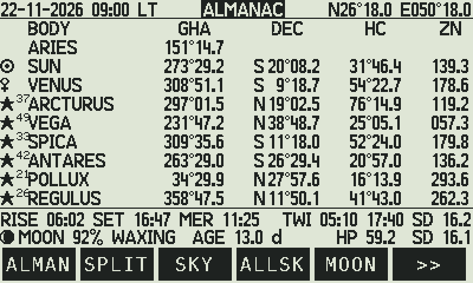

ARIES and the 8 bodies of the moment: the Sun, the Moon, a planet, the brightest stars above the horizon. For each:
**GHA**, **Dec**, **Hc** (computed altitude) and **Zn** (true azimuth) from your position. At the bottom: sunrise,
sunset, meridian passage, twilight, the semi-diameters, the Moon's phase and age.

### SPLIT, SKY, ALL SKY

| | |
|---|---|
| 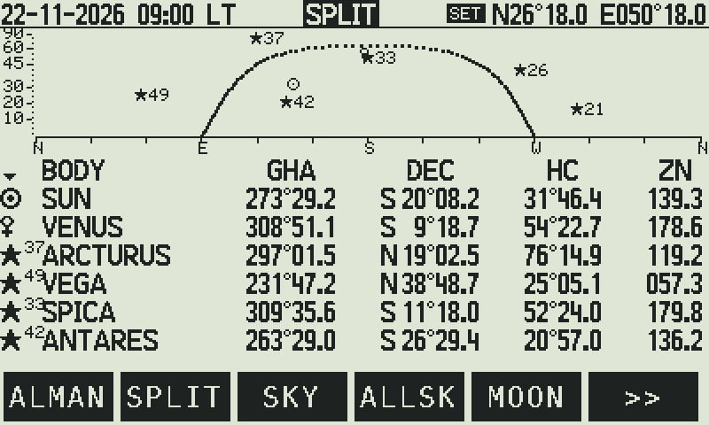 | 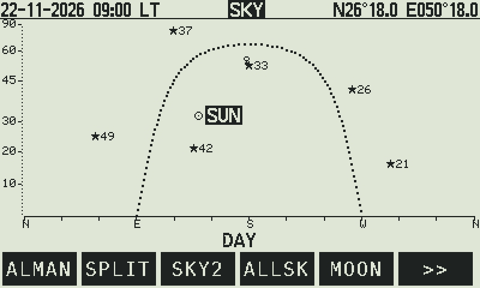 |
| **SPLIT**: the horizon chart above the table. **8 2** scroll the bodies. | **SKY**: the horizon chart on a sine scale with the celestial equator; the bodies' names one a second. **SKY** again (or **0**): SKY2, the dome seen from above. |

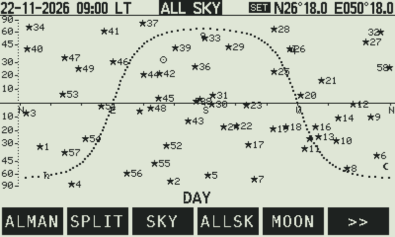

**ALL SKY**: all 58 navigation stars, the planets, the Moon and the Sun, above and below the horizon.

### MOON and ANIM

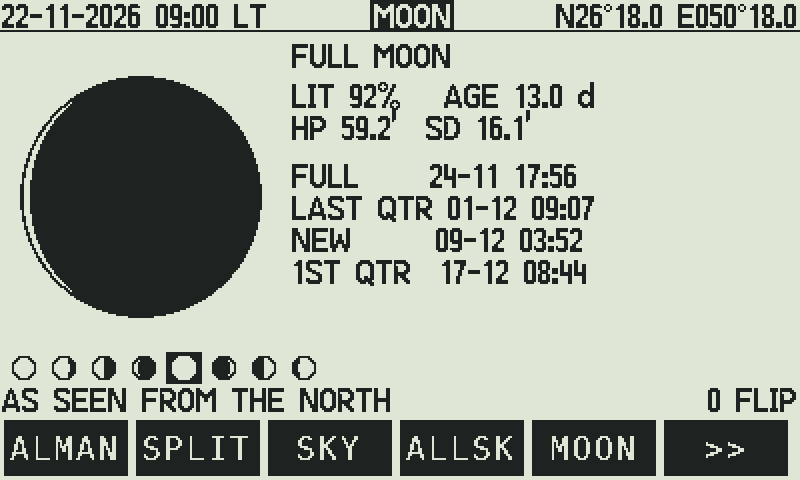

**MOON** (MOON47): the disc as seen from your latitude, the phase and the time to the next one ("FULL IN 2.4 d"),
% illuminated, age, HP and SD, the next four phases. NEW MOON, FIRST QUARTER, FULL MOON and LAST QUARTER are instants:
the page names them within half a day of the instant, and in between says crescent or gibbous (two days before the
full: WAXING GIBBOUS, FULL IN 2 d). The disc is drawn as the almanacs do: the lit part white, the dark part black
(○ full, ● new). **0** shows it as seen from the south. **ANIM** plays the Sun and the Moon across the sky: 24 frames, 30
minutes apart.

---

## Tides and streams

### T&F: tide and flow

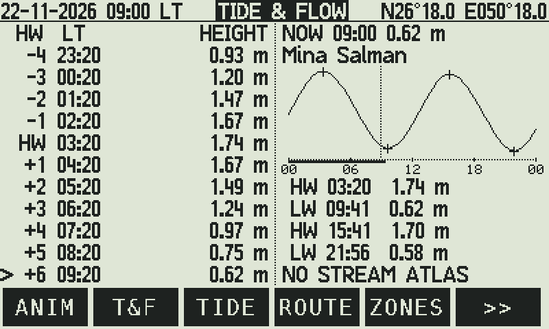

The tide and the stream on one page, as ARTF47: HW−6 … HW+6 with the stream of your FLOW atlas at your position (set,
knots, an arrow), and the tide of the nearest port (curve, high and low waters). Without an atlas it shows the
chosen station's heights or stream.

| Key | Does |
|---|---|
| **4 6** | the High Water before / after |
| **1 3** | the day before / after |
| **5** | now |
| **ENTER** | the station list |
| **0** | AUTO on / off: the stations nearest your position |

### TIDE: one station's day

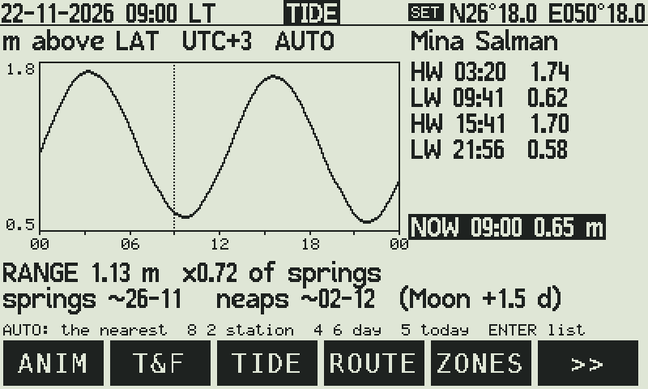

The chosen station's day: the curve, high and low waters (or slack, flood and ebb for a stream), now, the range
against springs, the next springs and neaps.

| Key | Does |
|---|---|
| **8 2** | the previous / next station |
| **4 6** | the day before / after |
| **5** | today |
| **ENTER** | the station list |
| **0** | AUTO: the station nearest your position |

TIDE keeps the station's own time zone, as a printed tide table does.

---

## Passage planning

### ROUTE

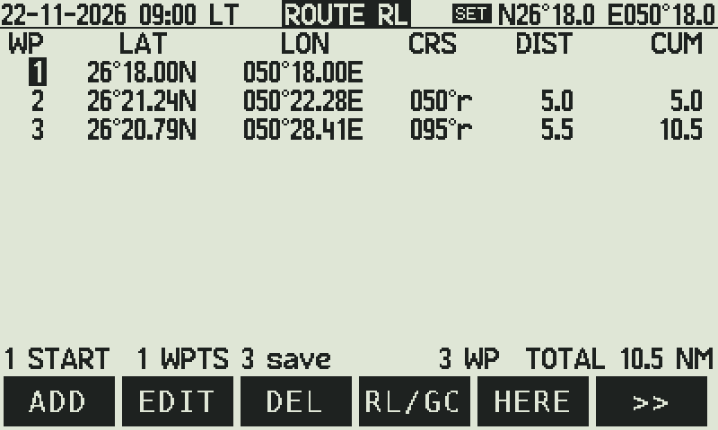

Your waypoints (up to 100), their positions to 0.01′ (as the web page plans them; type 26.3012 for 26°30.12′), and each leg from the one before, with its sailing after the course (R rhumb, G great circle, C composite; a capital when the leg has its own, small when it follows the route's RL/GC; **SHIFT RL/GC** cycles the cursor's leg: the route's, RL, GC, CS): **CRS** (true), **DIST** and **CUM** in nautical miles,
the total at the bottom. The name of the waypoint under the cursor shows at the bottom left.

| Key | Does |
|---|---|
| **ADD** | a new waypoint after the cursor: type LAT `DD.MMm` ENTER, LON `DDD.MMm` ENTER (**+/−** for S and W) |
| **EDIT** or **ENTER** | change the waypoint under the cursor |
| **DEL** | delete it |
| **RL/GC** | the sailing: **RL** rhumb line, **GC** great circle, **CS** composite (**4 6** its limiting latitude) |
| **HERE** | add SET's position (the GPS's when GPSSET → SET FOLLOWS is on) |
| **▲ ▼** / **8 2** | move the cursor |
| **1** | **WPTS**: take a waypoint from your list |
| **3** | save the waypoint under the cursor to your list |
| **R/S** | **PLAN** |
| **5** | **COMPARE**: the sailings and the ellipsoids on this leg |
| **0** | **CHART** |

The route is saved in `/NAV47/ROUTE.TXT`, one `lat lon NAME` a line. The web page reads and writes the same file.

### WPTS: your waypoints

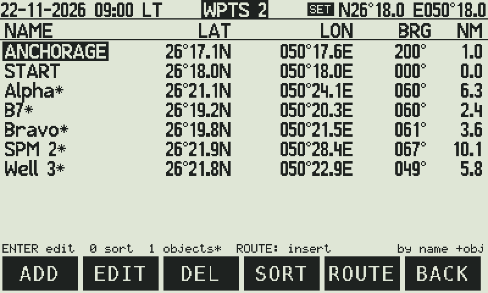

A list of up to 250 named waypoints, in `/NAV47/WAYPTS.CSV` (`name, lat, lon`). Open it from ROUTE (**1**) or FILES.

| Key | Does |
|---|---|
| **ADD** | a waypoint at your position now (the GPS's, else SET's), then its name, LAT and LON |
| **EDIT** / **DEL** | change / delete the waypoint under the cursor |
| **SORT** or **0** | by name, or the nearest first (with BRG and NM from you) |
| **1** | your platforms and objects too (marked `*`, from OBJECTS.CSV) |
| **ROUTE** (or **ENTER** from ROUTE) | put the waypoint into the route after its cursor, with its name |

**Typing a name** (HP-42S style): **F1–F6** choose a group of letters (`ABCDE` `FGHIJ` …), then **F1–F5** the
letter. The number keys type digits; **←** deletes; **ENTER** accepts.

### PLAN

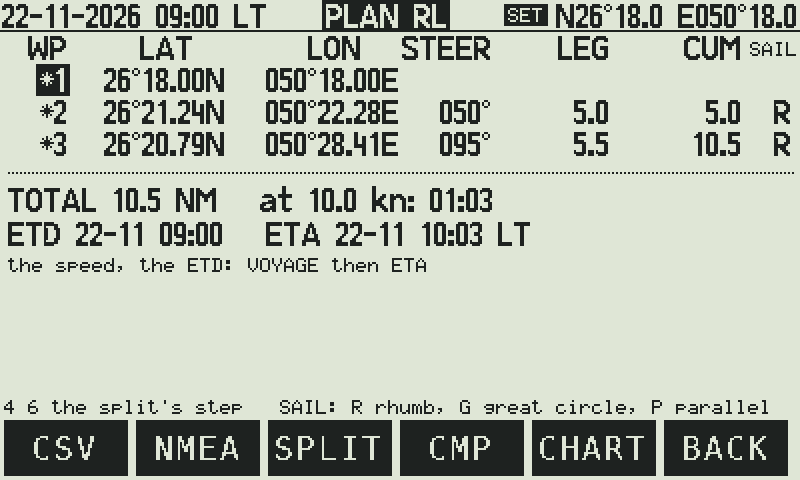

The route as it will be sailed: every point, each leg's course to steer and distance, the cumulative distance and
the ETA at the voyage speed. **SPLIT** divides the legs (every so many NM, into equal legs, or on whole meridians);
**4 6** change the step. **CSV** (or ENTER) and **NMEA** (or SHIFT ENTER) write `/NAV47/ROUTES/PLAN.CSV` and `PLAN.NMEA` (`$GPWPL` and
`$GPRTE`, also sent on USB channel 2). **CMP** compares the sailings; **CHART** draws it. **SAIL** (small, on the
right): **R** rhumb line, **G** great circle, **P** the parallel of a composite sailing. Under a short route, ROUTE
and PLAN show the total, the time at the voyage speed, the ETD and the ETA (change them on VOYAGE → ETA).

### CHART and VOYAGE

| | |
|---|---|
| 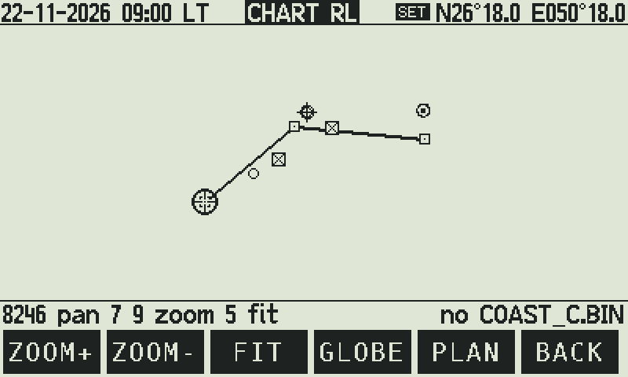 | 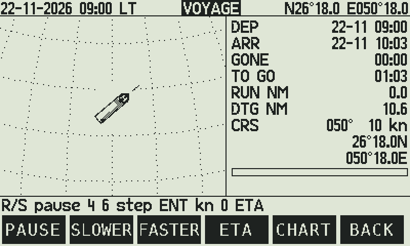 |
| **CHART**: Mercator or the globe (**0**), the coastline (`COAST_C.BIN` / `COAST_L.BIN` on the disk), the plan thick, the other sailings dashed and dotted, your platforms with their zones, the world's ports (`/NAV47/PORTS.CSV`, from the web page's Port to port card: a small square, the names when few are in view). Your waypoints' names (their numbers when unnamed), none over another: **3** hides or shows them. **8 2 4 6** pan, **7 9** zoom, **5** fit. **R/S**: VOYAGE. | **VOYAGE**: the plan sailed at the voyage speed on a globe that follows the vessel: departure, arrival, gone, to go, run, DTG, course, position, and the share sailed under the bar. **R/S** play, **4 6** step, **+ −** the speed, **1 3** the departure one hour earlier / later, **ENTER** type the speed, **0** ETA. |

### ETA

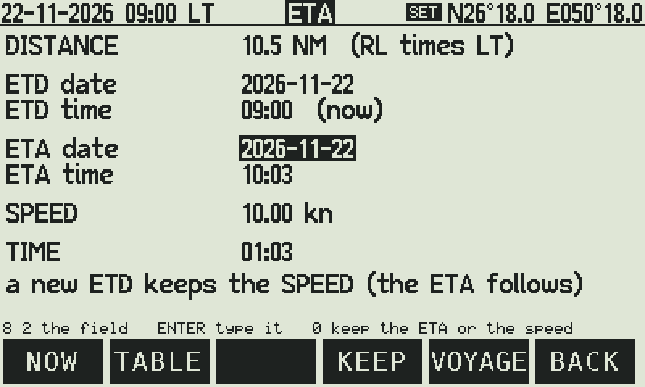

Departure (ETD), arrival (ETA) and speed for the plan's distance: set two, the third follows. **KEEP** decides
whether a new ETD keeps the ETA (the speed follows) or the speed (the ETA follows). **TABLE**: the ETA at the set
speed and a few slower ones.

---

## ZONES

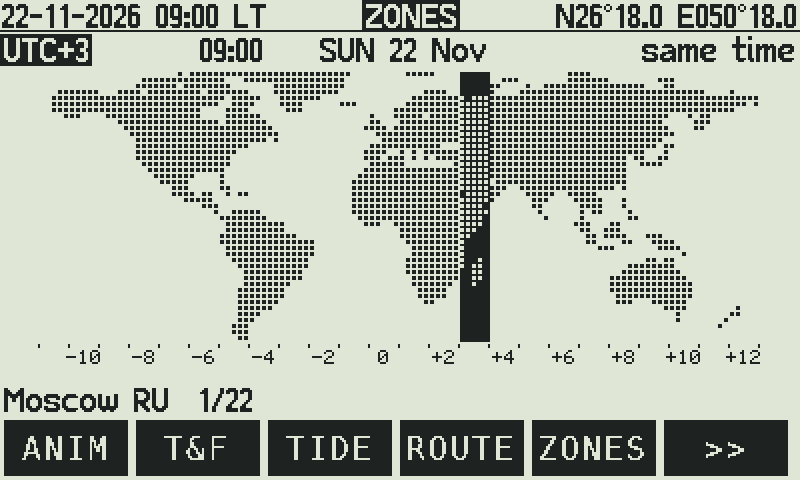

The world map with the time-zone column of your choice, its time and date now, summer time worked out on the
calculator (the IANA rules), and the cities of that zone.

| Key | Does |
|---|---|
| **4 6** | the zone to the west / east |
| **8 2** | the cities |
| **5** | the zone of your clock |

---

## SET, FILES, INFO, USB

| | |
|---|---|
| 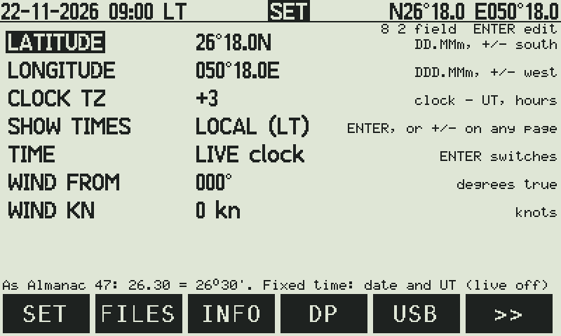 | 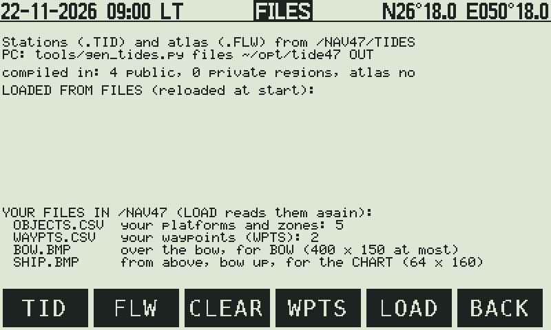 |
| **SET**: your position, the clock's zone, UT or local times, LIVE or FIXED time, **DUT1**, the wind (for FLOW and DP). **8 2** a field, **ENTER** edit; the help of the chosen field at the bottom. | **FILES**: load tide stations (**TID**) and a FLOW atlas (**FLW**) from `/NAV47/TIDES/`; **CLEAR** forgets them; **WPTS** your waypoints; **LOAD** reads your files in `/NAV47/` again. The page lists, in rows: the tide regions built in and loaded, the stream atlas, your objects and waypoints, the pictures. |

**DUT1** (UT1 − UTC, seconds, −0.9 to +0.9): the clock is UTC, and the almanac is computed at UT1 = UTC + DUT1
(0.1 s moves every GHA 1.5″). Get today's value on the web page's Almanac tab (**From IERS**) and type it here;
the time signals broadcast it to 0.1 s. Sights timed by GPS or a UTC clock: the IERS value. To check against the
Nautical Almanac at a tabulated time: 0, since its argument is already UT1.

**INFO**: about the program, the data compiled in, the USB state. **USB**: the calculator's screen on your
computer (`python3 tools/dm42view.py`), and the serial console the GPS uses.

---

## DP OPS and ABS SKP

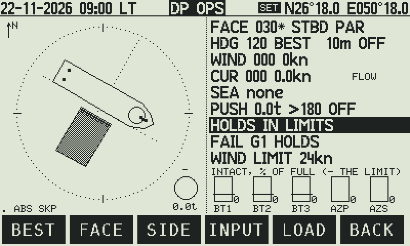

**DP OPS** asks: can the vessel hold station a few metres off a platform in today's wind, current and sea? At which
heading, inside the thrusters' working limits (a bow tunnel at 30 %), and after the worst single failure?

It uses DPCAP47's engine: the wind, current and wave-drift forces of **DNV-ST-0111 level 1** (× 1.25 dynamic
factor) and its thrust allocation. NAV47 adds the weather from three separate directions, the platform's lee, the
vessel placed STANDOFF metres off a face, and working limits on the thrusters.

| Key | Does |
|---|---|
| **BEST** or **ENTER** | try every heading every 5° (every face with FACE AUTO), keep the one with the most margin, find the wind she holds to |
| **FACE** / **SIDE** | the working face (0–3, AUTO); the side to it (stern, starboard, port, bow) |
| **INPUT** | the current, the sea, the standoff, the tolerance |
| **LOAD** | read `/NAV47/DPOPS.TXT` (the platform, made on the web page's DP tab) and the vessel file again |
| **4 6** | turn the heading by hand |
| **7 9** / **8 2** | the wind's direction ±10° / speed ±1 kn |
| **▲ ▼** | an hour later / earlier (the current follows the tide) |
| **0** / **3** | the bars after the worst failure / in tonnes |
| **1** | side to: parallel to the face, or within ± TOL |
| **.** | **ABS SKP** |

BEST and ABS SKP can take a while on the calculator: **any key stops them**. A stopped BEST keeps the best of the
headings tried so far ("BEST stopped", no wind limit); a stopped ABS SKP goes back to DP OPS ("ABS stopped").

### ABS SKP

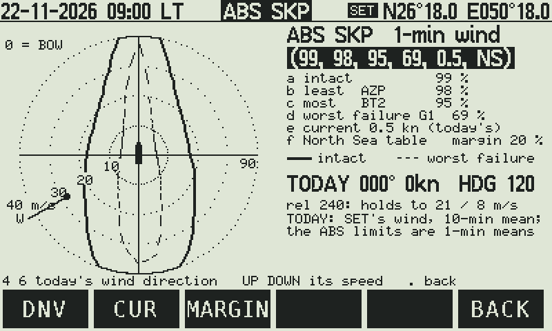

The vessel's station-keeping performance after the **ABS Guide for Dynamic Positioning Systems, Section 9**:
SKP(a, b, c, d, e, f), the share of the 36 directions in which the limiting wind (1-minute mean) is not exceeded in
the Guide's North Sea wind–wave table.

| | |
|---|---|
| **a** | intact |
| **b** | the least effective single thruster lost |
| **c** | the most effective single thruster lost |
| **d** | the worst redundancy group lost (the worst-case failure) |
| **e** | the current, knots: today's (to half a knot) or 0.5–3 kn (**7**) |
| **f** | the location: the North Sea table |

The polar shows the limiting wind from every direction (0 = the bow), intact (solid) and after the worst failure
(dashed), and today's wind against the DP OPS heading. **8** sets the margin on the weather (0–30 %, 20 % by default).
**4 6** turn today's wind 10° and **▲ ▼** change it 1 kn (SET's wind, as DP OPS's 7 9 8 2): the marker and its "holds to" move
at once; back on DP OPS, BEST runs again with it. The polar is computed again only if today's current (e) changes with it.
**.** or **DNV** goes back. This is the vessel's capability in every direction, not today's set-up at the platform.
The ABS limits are 1-minute means; SET's wind is a 10-minute mean.

The vessel is a DPCAP47 `.DPV` file (`/NAV47/VESSEL.DPV`, or the VESSEL line of DPOPS.TXT). Without one NAV47 uses
a made-up 95 m × 22 m DP2 vessel with three bow tunnels and two azimuths.

---

## Your files

Everything you can put in the calculator's `/NAV47/` folder. **FILES → LOAD** reads them again.

| File | What | Made by |
|---|---|---|
| `ROUTE.TXT` | the route: `lat lon NAME` a line, and its settings | ROUTE, or the web page (*Save ROUTE.TXT*) |
| `WAYPTS.CSV` | your waypoints: `name, lat, lon` | WPTS, the web page (*WAYPTS.CSV*), or any editor |
| `OBJECTS.CSV` | your platforms, rigs, wellheads, SPMs, wrecks, buoys, lights, ports and their keep-out zones | the web page (*objects.csv*), or any editor |
| `BOW.BMP` | the view over your vessel's bow, for BOW | any paint program; see [the GPS manual](02-gps.md#your-vessels-pictures) |
| `SHIP.BMP` | your vessel from above, bow up, for the live CHART | any paint program |
| `DPOPS.TXT` | the platform for DP OPS | the web page's DP tab |
| `VESSEL.DPV` | your DP vessel | DPCAP47 |
| `TIDES/*.TID`, `*.FLW` | tide and stream stations; a FLOW atlas | `tools/gen_tides.py` |
| `COAST_C.BIN`, `COAST_L.BIN` | the coastline for CHART | `tools/prep_coast.py` |

`OBJECTS.CSV` columns: `type, name, lat, lon[, zone_m[, orient[, face_m[, side_m]]]]`, or just `name, lat, lon`.
Positions as `27.2` or `27 12.0N`. A header row may name the columns in any order. Without a zone, the default is
500 m for platforms, rigs, wellheads and SPMs, 100 m for wrecks, 50 m for buoys and lights.
