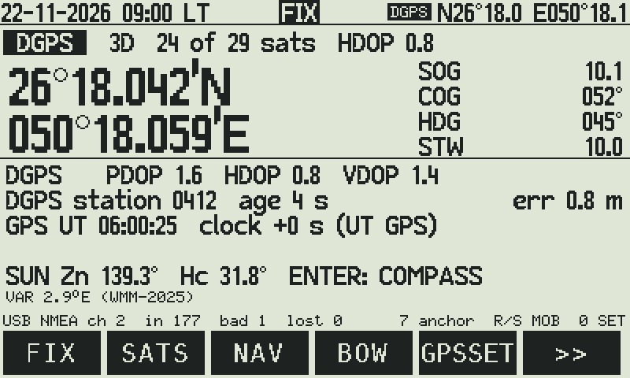
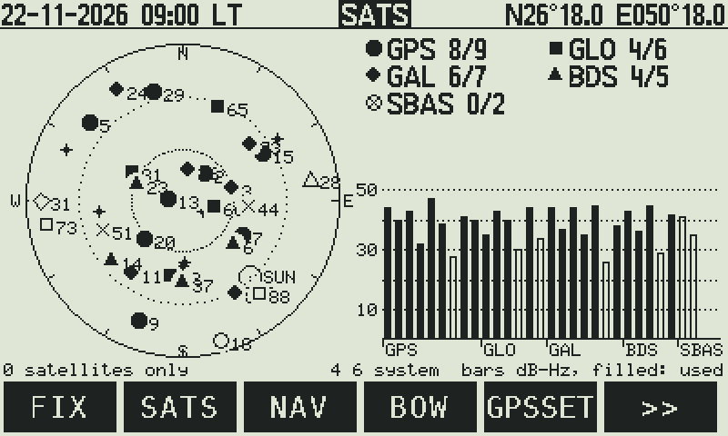
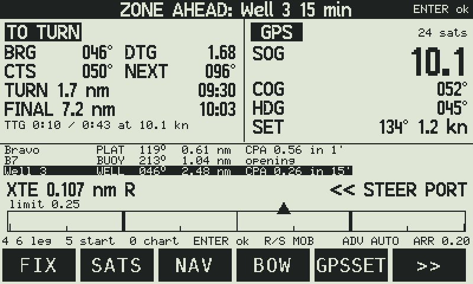
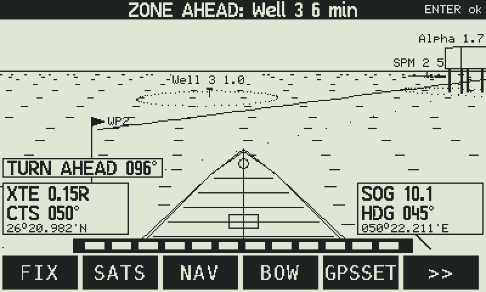
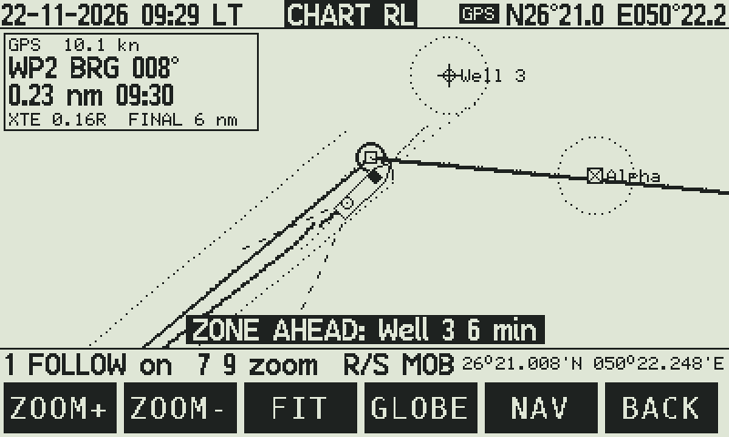
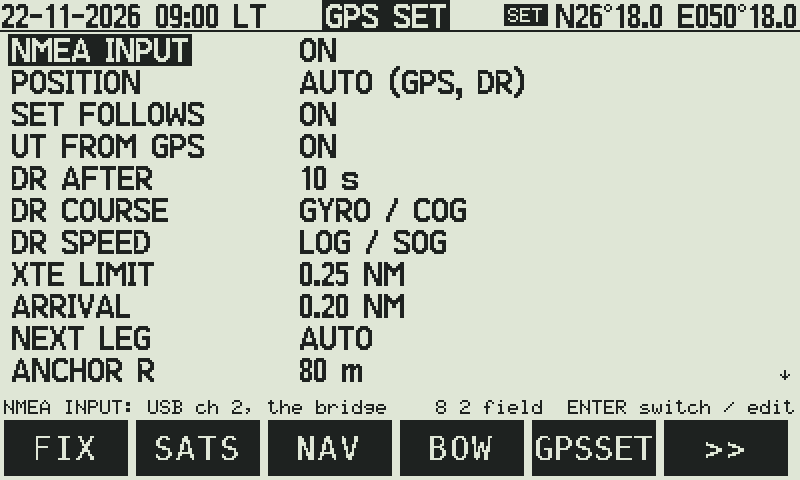
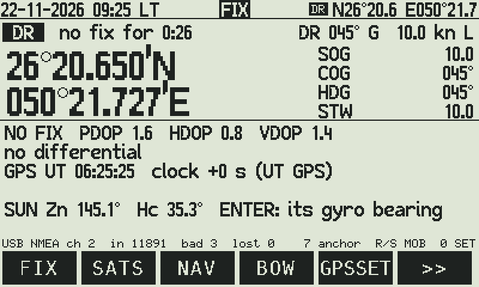
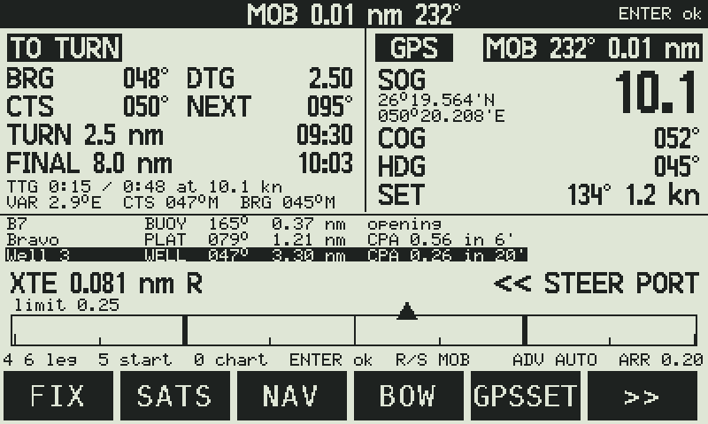
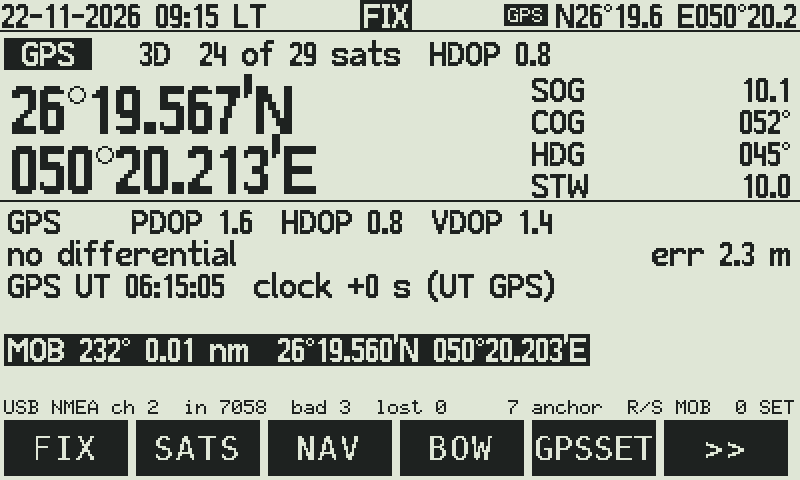
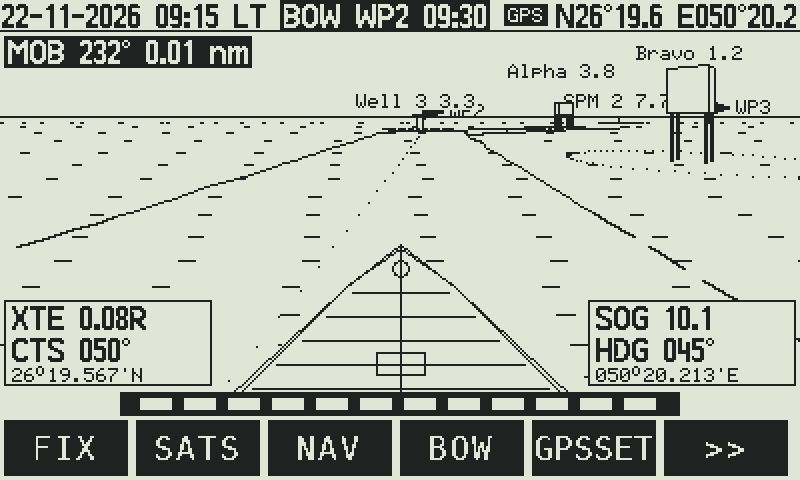

# 2. The GPS

NAV47 reads NMEA 0183 (a GPS, DGPS, the gyro, the log) and shows the fix, the satellites, the passage on your route,
the view over the bow and the vessel on the chart. Without a signal it keeps a dead reckoning.

- [Connecting the GPS or the ship's NMEA](#connecting-the-gps-or-the-ships-nmea)
- [The GPS pages](#the-gps-pages): FIX, SATS, NAV, BOW, the live CHART, GPSSET
- [DR: when the fix is lost](#dr-when-the-fix-is-lost)
- [Alarms, MOB, anchor watch, gyro error](#alarms-mob-anchor-watch-gyro-error)
- [Your vessel's pictures](#your-vessels-pictures)
- [Without any hardware: a log or the demo](#without-any-hardware-a-log-or-the-demo)
- [Troubleshooting](#troubleshooting)

---

## Connecting the GPS or the ship's NMEA

### Why a computer goes in between

The DM42n's USB-C port is a **USB device**, like a phone plugged into a PC. A GPS puck or a USB-serial adapter is a
device too, and two devices cannot talk to each other: one side must be a **host**, and the host must supply 5 V.
So a computer reads the NMEA and passes it to the calculator over USB. That computer is the **bridge**:

```
 GPS / ship's NMEA ──► adapter ──► laptop, Raspberry Pi or Chrome ──USB cable──► DM42n
 (RS-422, RS-232,      (USB)        tools/nmea_bridge.py, or the         NAV47: GPSSET
  USB, or UDP)                       web page's GPS tab                   NMEA INPUT ON
```

The bridge sends each sentence on the calculator's USB serial console, **channel 2** (a byte `0x12`, the sentence,
a line feed). The calculator holds only about three sentences at a time, so the bridge keeps the sentences NAV47
uses (RMC GGA GNS GSA VTG ZDA GST, HDT THS HDG, VHW; GSV every 5 s), always the latest, and paces them: 200 bytes
every 0.2 s.

### What you need

| Source | Adapter | Settings |
|---|---|---|
| The ship's NMEA 0183 line (RS-422, a differential pair) | an **isolated** RS-422 (or RS-422/485) to USB adapter | 4800 baud (NMEA 0183); **38400** for "high speed" outputs (AIS, some multiplexers); 8 data bits, no parity, 1 stop bit |
| A GPS with an RS-232 output | an RS-232 to USB adapter (FTDI, Prolific, CH340) | usually 4800 |
| A GPS module with a 3.3 V TTL output | a 3.3 V USB-TTL adapter | 9600 or 38400 (the module's setting) |
| A USB GPS puck | none: it is already USB | it appears as `/dev/ttyACM0` (or `ttyUSB0`) |
| The ship's network (a multiplexer or the ECDIS sending NMEA over UDP or TCP) | an Ethernet or Wi-Fi connection | the port it sends on, often **10110** |

### Wiring an NMEA 0183 line (RS-422)

An NMEA 0183 talker drives a differential pair, usually marked **A (+)** and **B (−)**, sometimes **TX+ / TX−**.
NAV47 only **listens**:

| Talker (the ship's output) | | Adapter input |
|---|---|---|
| A, + , TX+ | ──► | RX+ (or A) |
| B, − , TX− | ──► | RX− (or B) |
| signal ground (if there is one) | ──► | GND (an isolated adapter: its isolated side) |

- **Only connect to an output that is free** (a spare output of the GPS or the multiplexer), or in parallel with
  an existing listener: an NMEA talker drives several listeners. Never connect to an input or another talker.
- Use an **isolated** adapter. NMEA 0183 asks listeners to be isolated; it protects the ship's equipment and your
  laptop from ground loops.
- If nothing arrives, swap A and B: makers disagree about which is which.
- Ask the ship's electrician or ETO before touching the bridge's wiring.

### Step by step: a laptop (Linux or macOS)

1. **Give yourself the ports.** On Linux: `sudo usermod -aG uucp $USER` (Arch) or `dialout` (Debian, Ubuntu), then
   log out and in again.
2. **Plug in the adapter** and find it:
   ```
   ls /dev/serial/by-id/          # or: ls /dev/ttyUSB* /dev/ttyACM*
   ```
3. **Check the sentences come**, without the calculator:
   ```
   python3 tools/nmea_bridge.py --serial /dev/ttyUSB0 --baud 4800 --calc - --print
   ```
   You should see `$GPRMC`, `$GPGGA`… lines. Nothing, or rubbish: the baud rate (try 38400), or swap A and B.
4. **Connect the calculator** with its USB cable, start NAV47, and turn the input on: `>>` until the GPS row,
   **GPSSET** → **NMEA INPUT** → **ENTER** (ON).
5. **Run the bridge** (it finds the DM42n by name):
   ```
   python3 tools/nmea_bridge.py --serial /dev/ttyUSB0 --baud 4800
   ```
6. On the calculator, **FIX** shows the position and **DGPS** or **GPS** within a few seconds.

More inputs, together (the GPS and the gyro on two ports, or the network):

```
# the GPS and the gyro, on two ports
python3 tools/nmea_bridge.py --serial /dev/ttyUSB0 --serial /dev/ttyUSB1:4800
# the ship's network (UDP)
python3 tools/nmea_bridge.py --udp 10110
# a multiplexer's TCP port
python3 tools/nmea_bridge.py --tcp 192.168.1.10:10110
# gpsd
python3 tools/nmea_bridge.py --gpsd localhost:2947
```

The bridge uses the operating system's serial ports directly (no extra Python packages), so it runs on Linux and
macOS. On **Windows**, use the web page's GPS tab instead (below).

### A Raspberry Pi as a permanent bridge

A Raspberry Pi (a Pi Zero 2 W is enough) can stay on the bridge, powered from the ship, with the adapter and the
calculator plugged in. Start the bridge at boot with a systemd service, `/etc/systemd/system/nav47-bridge.service`:

```
[Unit]
Description=NMEA to NAV47 (DM42n)
After=network.target

[Service]
ExecStart=/usr/bin/python3 /home/pi/nav47.pg5/tools/nmea_bridge.py \
          --serial /dev/ttyUSB0 --baud 4800
Restart=always
RestartSec=5
User=pi

[Install]
WantedBy=multi-user.target
```

Then `sudo systemctl enable --now nav47-bridge`. `Restart=always` starts it again when the calculator is unplugged
and plugged back in.

### Chrome as the bridge (any computer, also Windows)

The web page (`web/index.html`) can be the bridge with no Python: Chrome or Edge on a computer (Web Serial).

1. **GPS** tab → **Connect a GPS**: choose the adapter's port and the baud rate.
2. **Connect the DM42n**: choose the calculator's port. The page sends the sentences, paced like the bridge.
3. On the calculator: GPSSET → NMEA INPUT ON.

### An NMEA stream from a web site

Some ship systems publish the NMEA on a web page (a gateway, a SignalK server, a VDR or a multiplexer's web view).
The bridge reads serial, UDP, TCP and gpsd, not web pages, so:

1. **Look for a raw port first.** The same box almost always serves the NMEA on TCP too (SignalK, OpenCPN, Kplex,
   YachtDevices, Actisense: port **10110**). Then `python3 tools/nmea_bridge.py --tcp <its address>:10110 --print`.
2. **Else find what the page streams.** In Chrome: F12 → **Network**, reload. A **WS** entry (`ws://…`, `wss://…`) is
   a WebSocket; a request that never ends and keeps growing is an HTTP stream. Note its address and look at a few
   lines: plain `$GPRMC,…` is best; a prefix (`data: `) or JSON needs one more step.
3. **Relay it to the bridge's UDP input**, the bridge in one terminal, the relay in another:

   ```
   python3 tools/nmea_bridge.py --udp 10110 --print

   websocat -t wss://<site>/<path>  | socat -u - UDP-SENDTO:127.0.0.1:10110      # a WebSocket
   curl -sN http://<site>/<path>    | socat -u - UDP-SENDTO:127.0.0.1:10110      # an HTTP stream
   curl -sN http://<site>/<path> | sed -u 's/^data: //' | socat -u - UDP-SENDTO:127.0.0.1:10110   # with a prefix
   ```

   A login: copy the cookie or token from the request in F12 (`curl -H 'Cookie: …'`, `websocat -H 'Cookie: …'`).
4. `--print` shows what the bridge keeps. Drop it, plug in the DM42n, GPSSET → NMEA INPUT ON; FIX's `in` counter
   climbs, `bad` stays near 0.

---

## The GPS pages

The fourth menu row: **FIX · SATS · NAV · BOW · GPSSET**. On every GPS page **R/S** marks a man overboard and
**ENTER** acknowledges an alarm.

**The position in the top bar.** While the GPS runs (NMEA INPUT on, or POSITION DR ONLY) a small tag before the
position in the top bar says where it comes from:

| Page | Position | Tag |
|---|---|---|
| the GPS pages and the live CHART | the vessel's, every second | **GPS**, **DGPS**, **RTK**… or **DR**; **SET** until the first fix |
| every other page (Almanac, Tide, Zones, ROUTE…) | SET's: what the page computes with | the GPS's source when SET FOLLOWS is on (SET is at most a minute old), **SET** when it is off |

With the GPS off there is no tag and the bar is as before.

### FIX



| | |
|---|---|
| the source | **DGPS**, **GPS**, **RTK**, **DR** (dead reckoning) or **SET** (GPS off) |
| the fix | 2D / 3D, satellites used of those seen, HDOP |
| the position | large, in degrees and minutes to 0.001′ |
| the motion | SOG, COG, HDG (the gyro), STW (the log) |
| the quality | PDOP, HDOP, VDOP; the DGPS reference station and the age of its corrections; the error estimate (GST, 1σ) |
| the time | the GPS's UT against the calculator's clock |
| the input | sentences received, bad checksums, lines lost |

**7** drops the anchor (the anchor watch); **ENTER** takes the Sun's bearing by the gyro (the gyro error); **0** GPSSET.

### SATS



The sky as the GPS sees it: each satellite at its elevation and azimuth, a symbol a system (● GPS, ■ GLONASS,
◆ Galileo, ▲ BeiDou, ✕ SBAS and others), filled when it is used in the fix. The counts used / seen a system, and the
signal strength bars (dB-Hz). **4 6** show one system's bars; **0** puts the Sun, the Moon, the planets and the stars
on the same sky.

### NAV: the passage monitor



On the route of ROUTE (PLAN's points):

| | |
|---|---|
| **TO** | the next point (a waypoint's name, or "pt n" for a split point) |
| **BRG · DTG** | its bearing and distance from the vessel (true, nm) |
| **CTS · NEXT** | the leg's course at the vessel, and the next leg's course |
| next waypoint · **FINAL** | distance along the plan, and **ETA** |
| **TTG** | the times to go, at SOG (at the plan's speed when stopped) |
| **SOG**, COG, HDG, **SET** | the vessel's motion, and the current (set and drift); her position, small, under SOG |
| the objects | your three nearest objects: bearing, distance, **CPA** and in how long; inverse when the CPA is inside its zone |
| **XTE** | the cross-track error and its bar, the limits marked, "STEER PORT / STBD" |

| Key | Does |
|---|---|
| **4 6** | the previous / next leg, by hand |
| **5** | start on the leg nearest the vessel |
| **0** | the live CHART |

The next leg comes by itself when the vessel enters the arrival circle or passes the waypoint (GPSSET: NEXT LEG AUTO).
Without a route NAV shows the position, the motion and the nearest objects.

### BOW: over the bow



The view from the helideck over the bow. The route is a lane to the horizon, its edges your XTE limits. The
waypoints have flags. Your platforms stand on jackets with their deck modules, at their outline, seen from 20 m;
they grow as the vessel closes and slide out of the view as she passes. Their zones are dotted on the sea. The Sun
and the Moon stand at their bearings. The sea moves at her speed. **TURN AHEAD 096°** shows near a waypoint. The
boxes beside the bow give XTE, CTS, SOG, HDG and her latitude (left) and longitude (right).

### The live CHART



From NAV (**0**): the vessel (to scale when the chart is close enough, else a 40-pixel symbol) with her wake, her
track (a point every 10 s), the COG vector (6 minutes), the active leg's XTE limits (dotted), the next point
ringed, your platforms and their zones. The box: the next waypoint's bearing, distance, ETA, XTE and the final
distance. **1** FOLLOW (she stays in the middle), **7 9** zoom (down to 0.6 nm across), **0** the globe. The strip
at the bottom gives her position to 0.001′, or the MOB's bearing and distance while one is marked.

### GPSSET



| Setting | |
|---|---|
| NMEA INPUT | ON: read channel 2 |
| POSITION | AUTO (the GPS, DR when the fix is lost), DR ONLY, OFF (SET's position) |
| SET FOLLOWS | the GPS's position to SET once a minute: the almanac, the tides (AUTO), the zones and HERE follow |
| UT FROM GPS | the GPS's UT instead of the clock (the clock itself is not changed) |
| DR AFTER | seconds without a fix before the DR starts (10) |
| DR COURSE / DR SPEED | typed, or the gyro / COG and the log / SOG |
| XTE LIMIT | nm, the alarm and the lane's width |
| ARRIVAL | nm, the arrival circle |
| NEXT LEG | AUTO or by hand |
| ANCHOR R | m, the anchor watch's radius |
| ALARMS | the beeps on or off |
| MOB | the MOB's position (`-` none); ENTER clears it. While a MOB is marked the help line shows its bearing and distance |

---

## DR: when the fix is lost



When no fix has come for DR AFTER seconds (10), the position goes on from the last fix:

- the **course**: DR COURSE if typed, else the **gyro**, else the last COG;
- the **speed**: DR SPEED if typed, else the **log** (STW), else the last SOG.

FIX shows **DR**, how long without a fix, and where the course and speed come from (G gyro, C COG, M typed; L log,
S SOG). The alarm **NO FIX: DEAD RECKONING** sounds. When the fix comes back, FIX shows how far the DR was off. This
is the classic DR: it does not allow for the current.

## Alarms, MOB, anchor watch, gyro error

| Alarm | When |
|---|---|
| OFF TRACK | the XTE is over the limit |
| WAYPOINT / ARRIVED | the vessel reached a waypoint / the final one |
| ZONE AHEAD | your course takes you inside an object's zone within 30 minutes (not your route's own departure and arrival platforms) |
| IN THE ZONE | the vessel is inside an object's zone |
| ANCHOR DRAGGING | outside the anchor watch's radius |
| NO FIX: DEAD RECKONING | the fix is lost |
| MOB | a man overboard is marked |

An alarm beeps and shows over the top bar; **ENTER** acknowledges it. MOB, anchor and zone alarms beep again every
5 s until acknowledged.



**MOB**: **R/S** on any GPS page or the live chart marks the position. Once the alarm is acknowledged the MOB stays in
sight, inverted, on every GPS page: its bearing and distance from the vessel (**MOB 232° 0.45 nm**), on FIX with its
position too, on NAV on the top row, on SATS and BOW in the corner, on GPSSET in the help line, on the live chart in
the bottom strip (else her position there, to 0.001′), where the chart also marks it. GPSSET's MOB row shows its
position; **ENTER** there clears it.

| | |
|---|---|
|  |  |

**Anchor watch**: **7** on FIX drops the anchor at the position now; the radius is GPSSET's ANCHOR R.

**Gyro error**: on FIX, **ENTER**, then type the Sun's bearing as read on the gyro repeater. NAV47 gives the Sun's
true azimuth (Zn) and the error: **ERR 1.5° LOW** (the gyro reads low: add) or **HIGH** (subtract).

## Your vessel's pictures

Two files in `/NAV47/`, made or changed with any paint program, saved as **BMP** (1, 4, 8, 24 or 32 bits, not
compressed):

| File | What | Size |
|---|---|---|
| `BOW.BMP` | the view over the bow from the bridge or the helideck, for BOW | up to 400 × 150 pixels, drawn at the bottom in the middle |
| `SHIP.BMP` | the vessel from above, **bow up**, for the live CHART | up to 64 × 160 pixels; turned to her heading, at her true length when the chart is close enough |

Draw in black on white. White touching the picture's edge (the sky and the sea round the vessel), and pure magenta
(255, 0, 255), are see-through: NAV47's own sea, lane and platforms show there. **FILES → LOAD** reads them again.

Templates (NAV47's own drawings) are in `docs/vessel/`. From a photograph:

```
# the bow from a photo; --top: the row of the stem in the photo; check.png shows the result
python3 tools/vessel_bmp.py bow photo.jpg BOW.BMP --top 820 --dither --png check.png
# the vessel from above, bow up
python3 tools/vessel_bmp.py ship from_above.png SHIP.BMP --length 64
# the templates
python3 tools/vessel_bmp.py templates /tmp/vessel
```

The web page takes the same files (Route tab, Bow view: *Bow picture*, *Ship icon*). A photograph of your ship
stays yours: do not commit it to the repository.

## Without any hardware: a log or the demo

```
# a made-up voyage
python3 test/nmea/make_log.py /tmp/log.nmea --minutes 60 --legs 045:30,090:30
# to the calculator, at its own pace or 10 times faster
python3 tools/nmea_bridge.py --file /tmp/log.nmea
python3 tools/nmea_bridge.py --file /tmp/log.nmea --speed 10
```

The log has GPS, GLONASS, Galileo and BeiDou satellites, a DGPS fix, a gyro and a log, a current of 1.2 kn and a
90-second loss of the fix. The web page's **Demo** sails your route instead.

## Troubleshooting

| What you see | Try |
|---|---|
| FIX: "input OFF" | GPSSET → NMEA INPUT → ENTER |
| FIX: "waiting for NMEA" | the bridge running? the calculator's cable in? `--print` on the bridge shows what it sends |
| the bridge: no sentences | the baud rate (4800 or 38400); swap A and B; the adapter's port |
| the bridge: "permission denied" | add yourself to `uucp` or `dialout`, log in again |
| FIX: "lost" climbs | too much for the calculator's buffer: do not use `--all`; one bridge only |
| HDG "---" | no gyro sentence (HDT, THS, or HDG with variation) in the NMEA |
| SET "---" | the current needs the gyro and the log (or a DR SPEED typed) |
| the top bar says **SET** while the GPS runs | on a GPS page: no fix yet; elsewhere: GPSSET → SET FOLLOWS is off, the page computes for SET's position |
| no tag in the top bar | the GPS is off (NMEA INPUT OFF), or POSITION OFF |
| NAV: OFF TRACK hundreds of miles | the route on the calculator is another one: send yours (web: *To the calculator*) |
