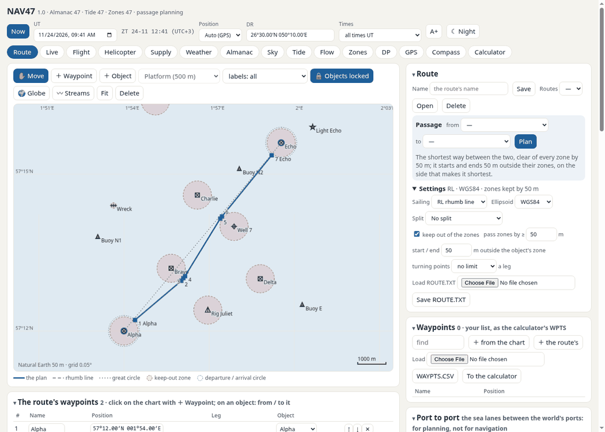
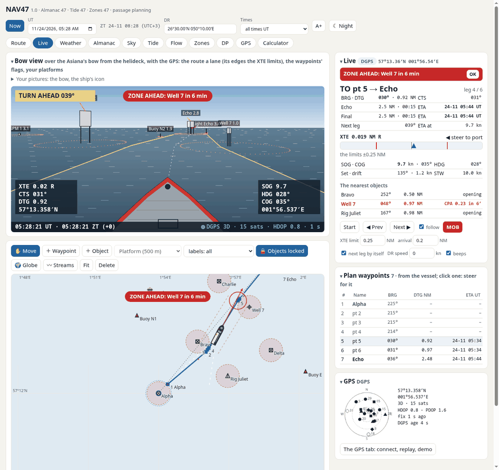
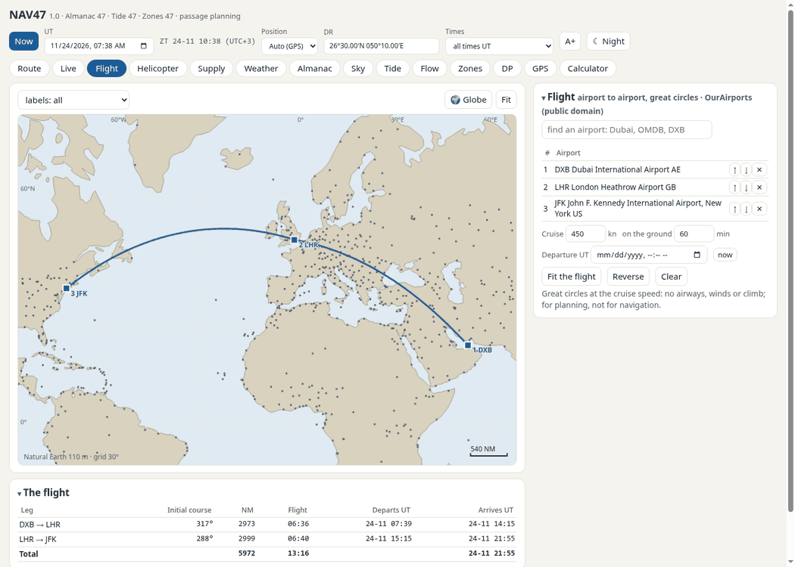
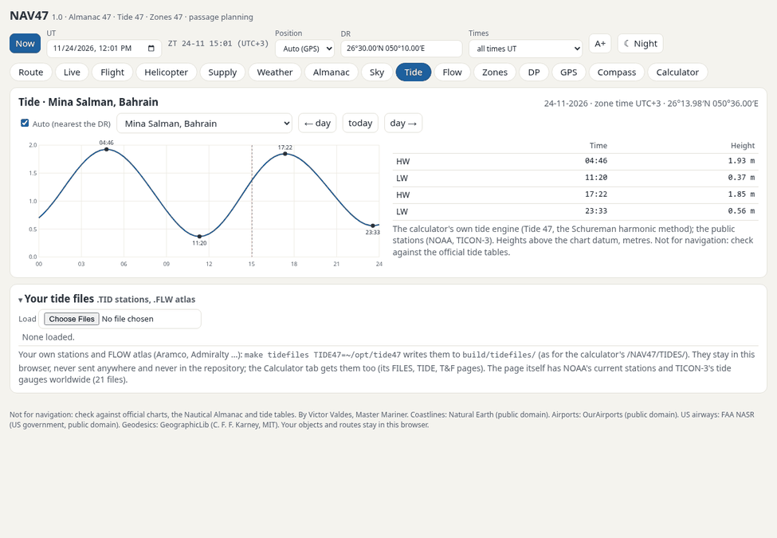
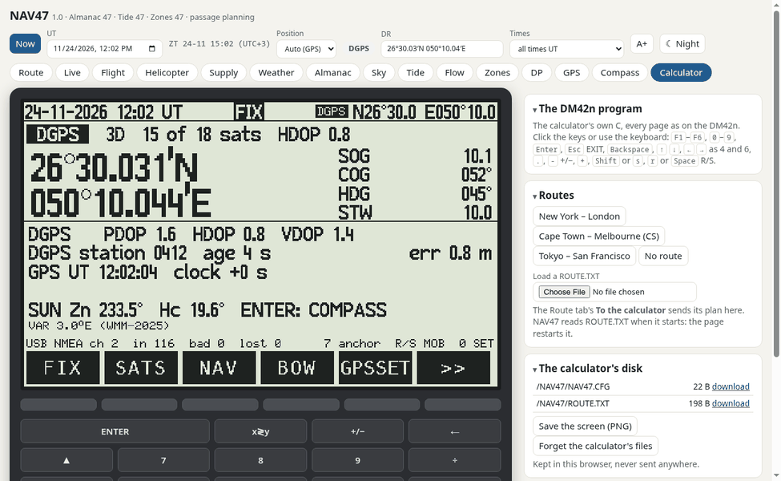

# 3. The web page

`web/index.html` is NAV47 in a browser. Open it as a file: no server and no installation. Every number comes from the
calculator's own C, compiled to WebAssembly in `web/nav47.js`, so the page and the calculator agree.

Your objects, routes and settings stay in the browser (localStorage). Nothing is sent anywhere, except by the Weather
tab when you switch it on.

- [Route](#route): plan, check, voyage
- [Live](#live-navigating-with-the-gps): the route monitored with the GPS
- [Flight, Helicopter, Supply](#flight-helicopter-supply): airport to airport; the field's helidecks and supply runs, the shortest round trips
- [GPS](#gps)
- [Almanac, Sky, Tide, Flow, Zones, Weather, DP](#the-other-tabs)
- [Calculator](#calculator)

The top bar, on every tab: **Now** (the clock) or a fixed UT; **Position**: **Auto (GPS)** or **Manual**, as the
calculator's POSITION AUTO and SET FOLLOWS; the **DR**, the position every tab computes with. With Auto and a GPS
running (the GPS tab: a GPS, a log, the Demo), the DR is the GPS's position, every second, a tag before it saying
whence: **GPS**, **DGPS**, **RTK**… green, **DR** amber (the fix lost: the dead reckoning), **NO FIX**; the tab shown
(the Almanac, the tides, the zones…) is computed again every 10 s. **Manual** (**MAN** while a GPS runs), or a DR
typed: the position is yours. No GPS: no tag, the DR is yours. The times in **UT** or **ZT** (the DR's zone); **A+** a larger text, and **☾ Night**: red on black, the charts too, to keep the eyes
dark-adapted on the bridge (both kept in this browser).

**Cards fold** at their title (▾ / ▸): the Route tab's long column shortens to the cards in use, and the page
remembers which are folded. The Route card's **Settings** (sailing, ellipsoid, split, zones) fold too, a line saying
what they are. The GPS tab's raw sentences are folded: **Show the last sentences**.

---

## Route

| Card | |
|---|---|
| the chart | Mercator or the globe; drag, zoom with the wheel, **Fit**; the coastline (Natural Earth); your objects and their keep-out zones; the plan in blue |
| **The route's waypoints** | under the chart, wide, above the Plan: name, position, **Leg**, the object it is tied to, ↑ ↓ ✕; click the chart with **＋ Waypoint**, or type; **Reverse**, **Clear**, the Cape Town example |
| **Route** | the route's name and library; **Passage**: from one object to another, round every zone; the sailing (RL, GC, CS), the ellipsoid, the split; *keep out of the zones* with a clearance (**pass zones by**: the least, the route the shortest that keeps it, a few metres over), **start / end** outside the objects (0 m: on their zone), **turning points**: at most 1–10 a leg round the zones (fewer turns, a little longer; "needs N" when there is no way with fewer); every point of the plan to 0.01′, rounded away from the zones and checked again |
| **Leg** sailing | each leg its own sailing (the waypoint table's and the Plan's **Leg**: route / RL / GC / CS): a great circle across the ocean, rhumb lines along the coast; drawn so on the chart and the globe; to the calculator in ROUTE.TXT (`LEGS`), which sails them the same |
| **Plan** table | your waypoints' rows edited there too (name, position, leg); **Sail** the planned sailing; **✎** makes a split or turning point one of your waypoints |
| **labels** | the chart's labels: all, your waypoints only, or off (zoomed out they crowd) |
| **Take over the plan** | (Plan card) the planned points become your waypoints: the turns named TP1, TP2…, untied from the platforms (the departure too); rename, move, type, delete them freely, the planner stays off; the Check still warns of the zones and the land; **Plan round the zones again** gives the passage back |
| route **Name**, **Routes** | your routes kept by name in the browser: Save, Open, Delete; the name goes into ROUTE.TXT (`NAME …`) |
| **Waypoints** | your list, the calculator's WPTS on the web: find, ＋ from the chart, ＋ the route's, edit the name and position, **→ route** (after the selected waypoint), WAYPTS.CSV in and out, **To the calculator** |
| **Port to port** | the world's ports (NGA's World Port Index) along the sea lanes (Eurostat SeaRoute's network): find ports by any of their names (Dubai or the index's Dubayy; with NGA's CSV also the UN/LOCODE, AEDXB), or click them on the chart (the ports' layer); a voyage of several ports, days in each; Suez, Panama, the Arctic passages on or off, and for a canal used the distance without it; speed, the fuel in t/day at a service speed (× (speed / service speed)³) and in port, the ETD: each leg's miles, days, fuel, departure and arrival, the voyage's totals; drawn on the chart (**Fit the voyage**: Mercator or the globe); **To the route**: the lanes' turning points as your waypoints (within a few minutes, 99 at most, a shortcut over land avoided), so to the calculator as ROUTE.TXT; **PORTS.CSV** for the calculator; the miles inside the **Emission Control Areas** each leg (green on the chart) and the low-sulphur fuel they take: Baltic, North Sea, Mediterranean (from May 2025) by MARPOL's defining lines, North America and the US Caribbean approximate (±30 NM). For planning, not for navigation: the lanes are simplified (20 km), a published distance table may differ by a few percent |
| **Check** | the route against the coastline (Natural Earth 50 m) and your zones: the closest pass, legs over land or into a zone in red |
| **Plan** | every point: course to steer, leg, cumulative distance, ETA. **CSV**, **NMEA**, **GPX**, **ROUTE.TXT**, **WAYPTS.CSV**; **To the calculator** sends the route and your objects to the Calculator tab |
| **Voyage** | speed (a vessel: 1 to 100 kn; flights have their own tab), departure, arrival (typed: the speed it needs); **Play** sails the plan with the Mermaid Asiana; the ETA at slower speeds. Over 30 kn the bridge has a word to say, once |
| **Objects** | your platforms, rigs, wellheads, SPMs, wrecks, buoys, lights and ports: add them on the chart, or load a CSV, GeoJSON, GPX or KML; each zone can be changed; a platform can have its outline (orientation, sides). **🔒 Objects locked** (the chart's toolbar, on at first): they cannot be dragged, edited or deleted, only the waypoints change; From / To / ＋WP still work |
| **Compare** | great circle, rhumb line and composite on each ellipsoid |

`#ex=field` in the address loads a made-up oil field to try it.

## Live: navigating with the GPS

The navigation, apart from the planning: with a GPS source (the GPS tab: a GPS, a log, or the **Demo**; or
**Demo along this route** on the Live card) the Live tab monitors the route with the calculator's own passage
engine. The chart is the Route tab's own (the same zoom, objects and labels), following the vessel.

| | |
|---|---|
| **Bow view** | as the calculator's BOW: over the bow from the helideck, the route a lane to the horizon, the waypoints' flags, the platforms in perspective with their zones, TURN AHEAD; in boxes black on white, on the left XTE, CTS and DTG, on the right her own: latitude, longitude, HDG and SOG; along the bottom the time (UT and the DR's zone time, to the second) and the fix: its kind (GPS, DGPS, RTK… green; DR amber), 3D, the satellites used, HDOP, the fix's age. *Your pictures* (folded): the calculator's `BOW.BMP` and `SHIP.BMP`, or PNG / JPG |
| the chart | the Mermaid Asiana (or your icon) with her wake, her track, the XTE limits, the arrival circle, the alarm |
| **Live** card | **TO** the next point and waypoint; BRG, DTG, CTS; the next leg; the next waypoint's and the final **ETA** and time to go; the **XTE** bar with the limits and "steer to port / starboard"; SOG, COG, HDG, STW; **set and drift**; your three nearest objects with their **CPA**; the alarms. **Start** (the leg nearest the vessel), **◀ Prev**, **Next ▶**, **follow**, **MOB**; the XTE limit, the arrival circle, the next leg by itself, a DR speed, the beeps |
| **Plan waypoints** | every point of the plan from the vessel: its bearing, the distance along the plan, the ETA at the speed made good; the one steered for highlighted, those passed dimmed; **click one** to steer for it |
| **GPS** | the position to 0.001′, the fix, satellites, HDOP and PDOP, the fix's and the corrections' age, the satellites' sky; the GPS tab for the rest |

While the GPS is live the Voyage player waits: there is one vessel on the chart, the real one.

To see it with no hardware: open `web/index.html#tab=live&ex=field&gpsdemo&gpsx=30` (the demo sails the example
field's route 30 times faster).

## Flight, Helicopter, Supply

Three planning views on the same chart (its route and tools step aside; **Fit** fits the view's own route). Each
finds its order of stops by itself (**shortest**: exact up to 13 stops, then a good one) or keeps yours (**my
order**), and lists every leg with its distance, time and ETA under the chart. **Departure**: the field shows it; **now** (lit)
follows the clock, a time typed fixes it, **now** again goes back to the clock.

**Simulation** (each view): **Play** flies the plane, the helicopter (its rotor turning) or sails the supply vessel
along the trip, the whole of it in 20 to 160 s; the slider goes to any moment; **follow** keeps her on the chart. A
box gives the time (UT or ZT), the leg or the stay (on the ground, on deck, refuelling, alongside) and the time left
there, the course and speed, the position, the miles and time to go, the arrival or the return to the base.

| | |
|---|---|
| **Flight** | airport to airport: the world's large and medium airports (OurAirports, public domain), found by name, city, ICAO or IATA code (Dubai, OMDB, DXB), or clicked on the chart (zoomed in, the medium ones too); as many as you like, ↑ ↓ ✕, **Reverse**; the cruise speed, the time on the ground at each stop, the departure: each leg's initial course, NM, flight time, departure and arrival, the totals. **by airways** (on): each leg from the departure to an airway point within 100 NM, along the airways by the shortest way, to the arrival; the table gives the route (the first point, the airways, the last), its NM and the great circle's, and how much longer; the chart draws it, the great circle dashed beside; the simulation flies it. No airway within 100 NM: direct. The airways from the free sources only: built in, the **FAA's US airways** (NASR, the US government's: no copyright; `tools/gen_airways.py` each 28-day cycle); **Your airways**: X-Plane's files (`earth_awy.dat` with `earth_fix.dat` and `earth_nav.dat`, a simulator's or Navigraph's, worldwide), kept in this browser only (**Forget my file**). No SIDs, STARs, one-way rules or levels: planning, not a flight plan. No wind or climb. `#tab=flight&fl=DXB,LHR,JFK` opens with a flight |
| **Helicopter** | from **Ras Tanajib** or **Ras Tanura** (their airports and heliports, OurAirports) to the field's helidecks: your **ACP** platforms (the accommodation platforms: ACP in the name) and your **rigs** (objects of the type Rig). Tick them, or click them on the chart (a ring marks each helideck). The round trip: from the base, every deck, back to the base, in the order of least flying. Cruise 140 kn, endurance 2 h 30 with a 30 min reserve, 10 min on each deck, 20 min to refuel (all to change). Every ACP refuels: where the endurance less the reserve would not reach the next deck and then fuel, it refuels on the deck it is on, or turns aside to the best ACP on the way; ⛽ on the chart and in the table. The totals: decks, NM, flying time, the time in all, back at the base |
| **Supply** | a supply vessel from **Tanajib** (the marine port) or **Ras Tanura** round your platforms (find them by name, or click them on the chart): the schedule of least steaming, back to the base; 12 kn, 2 h alongside each (each its own, typed in the table); **a trip at most** so many hours: the schedule split into trips, home between them. **To the route**: the schedule into the Route tab, its legs planned round the zones (a little longer than the straight miles here), so to the calculator as ROUTE.TXT |

The platforms are yours: the Route tab's **Objects** card (a CSV of your field), kept in this browser and never
sent anywhere; nothing of them is in the page or the repository.

## GPS

| | |
|---|---|
| **Connect a GPS** | a GPS, or the ship's NMEA through a USB adapter, with Chrome or Edge on a computer (Web Serial); the baud rate |
| **Replay a log** | an NMEA file, 1 to 10 times faster |
| **Demo** | a made-up vessel: along your route if there is one; 1 to 60 times faster |
| the fix | the quality (DGPS, GPS, RTK), satellites used a system, the position, SOG COG HDG STW, set and drift, DOP, DGPS station, GST error, the GPS time |
| the satellites | the sky plot and the signal bars, as the calculator's SATS |
| *The DR follows the GPS* | every 10 s the page's DR becomes the GPS's position: the Almanac, Tide, Zones and Route tabs follow |
| **To the calculator** | to the Calculator tab's program (*Open on the calculator*: its FIX page), and **Connect the DM42n**: the page as the bridge to the real calculator over USB |

## The other tabs

| | |
|---|---|
|  |  |
| **Almanac**: the Sun, the Moon, the planets and the stars above 10°: GHA, Dec, Hc, Zn; the Sun's day; the Moon's phases; **DUT1** (UT1 − UTC) typed or **From IERS** (online: IERS data through CelesTrak), for the calculator's SET. | **Sky**: the dome from the DR, and the brightest stars for sights. |
|  |  |
| **Tide**: the public stations, NOAA's current stations and your own `.TID` files: the day's curve, high and low waters (or the streams); **Auto**: the station nearest the DR. | **Zones**: the dot map in 24 columns of 15°, each zone's places and their local and summer time now. |

**Flow**: your FLOW atlas (`.FLW`) as the calculator's T&F: the stream at the DR from HW−6 to HW+6. **Weather**
(online, when you switch it on): the forecast hour by hour, rain radar and satellite clouds, with your route. **DP**:
the platform for DP OPS (`DPOPS.TXT` for the calculator), and the vessel's **ABS SKP** (the ABS DPS Guide, Section 9): the
polar of the limiting 1-minute wind intact and after the worst failure, SKP(a, b, c, d, e, NS), the current and the
margin chosen; the same C as the calculator's ABS SKP page, the same numbers.

## Calculator

The DM42n program itself, every page, the keys clicked or typed (F1–F6, 0–9, Enter, Esc for EXIT, arrows, `r` or
Space for R/S). Its disk is kept in the browser; *To the calculator* on the Route tab sends the route there. The
GPS tab feeds its GPS pages.

## The private page

`make web-private TIDE47=~/opt/tide47` builds the same page with your private tide data in
`build/web-private/index.html`, with a red **PRIVATE BUILD** banner. It is for your computer only: never publish it
or commit it.
