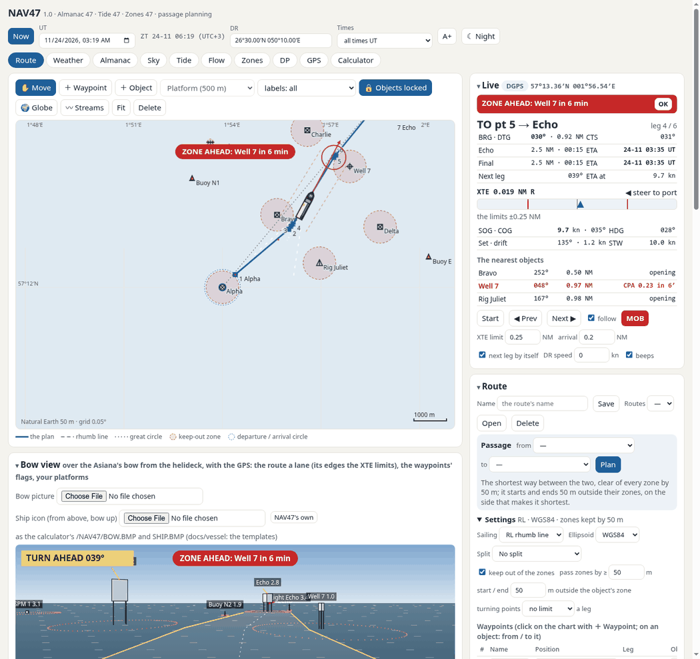
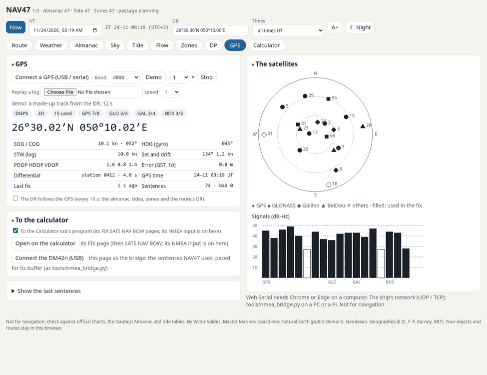
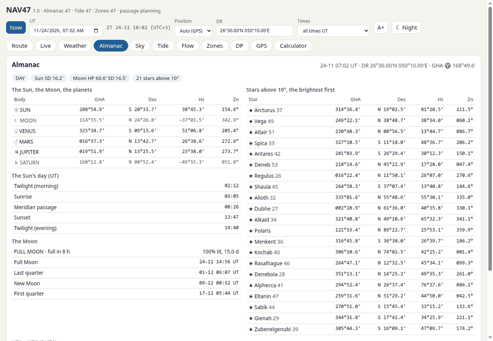
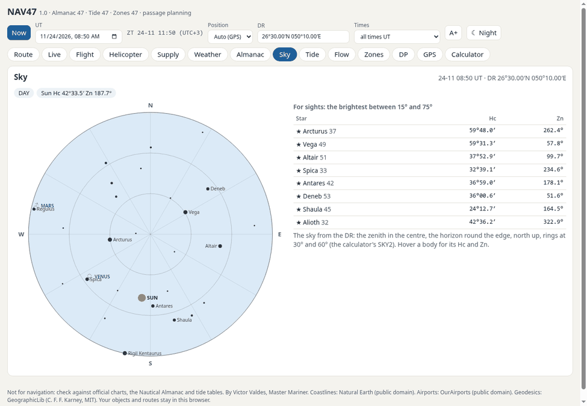
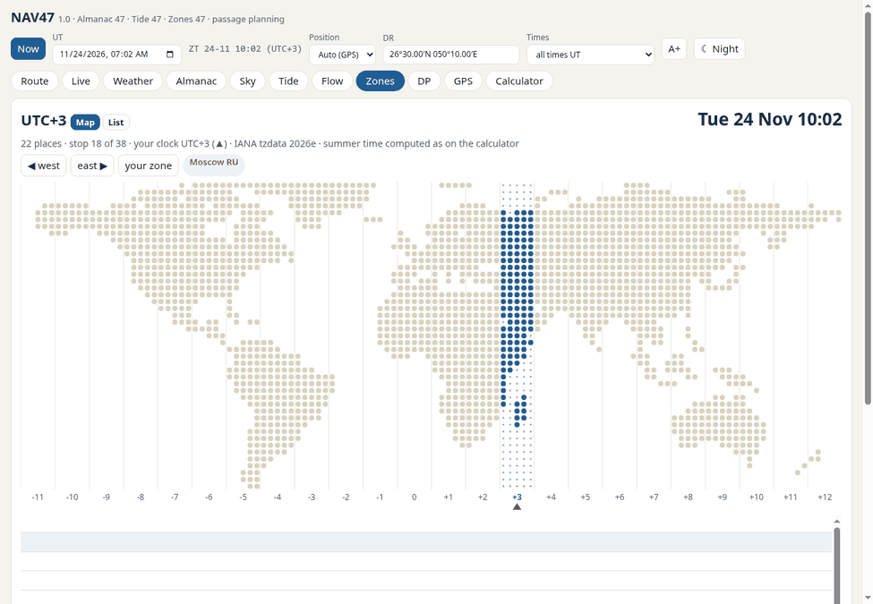

# 3. The web page

`web/index.html` is NAV47 in a browser. Open it as a file: no server and no installation. Every number comes from the
calculator's own C, compiled to WebAssembly in `web/nav47.js`, so the page and the calculator agree.

Your objects, routes and settings stay in the browser (localStorage). Nothing is sent anywhere, except by the Weather
tab when you switch it on.

- [Route](#route): plan, check, voyage
- [Route · Live](#route--live-the-route-with-the-gps): the route monitored with the GPS
- [GPS](#gps)
- [Almanac, Sky, Tide, Flow, Zones, Weather, DP](#the-other-tabs)
- [Calculator](#calculator)

The top bar, on every tab: **Now** (the clock) or a fixed UT; the **DR**, your position for every tab; the times in
**UT** or **ZT** (the DR's zone).

---

## Route

| Card | |
|---|---|
| the chart | Mercator or the globe; drag, zoom with the wheel, **Fit**; the coastline (Natural Earth); your objects and their keep-out zones; the plan in blue |
| **Route** | the waypoints (click the chart with **＋ Waypoint**, or type); **Passage**: from one object to another, round every zone; the sailing (RL, GC, CS), the ellipsoid, the split; *keep out of the zones* with a clearance (**pass zones by**: the least, the route the shortest that keeps it, a few metres over), **start / end** outside the objects (0 m: on their zone), **turning points**: at most 1–10 a leg round the zones (fewer turns, a little longer; "needs N" when there is no way with fewer); every point of the plan to 0.01′, rounded away from the zones and checked again |
| **Check** | the route against the coastline (Natural Earth 50 m) and your zones: the closest pass, legs over land or into a zone in red |
| **Plan** | every point: course to steer, leg, cumulative distance, ETA. **CSV**, **NMEA**, **GPX**, **ROUTE.TXT**, **WAYPTS.CSV**; **To the calculator** sends the route and your objects to the Calculator tab |
| **Voyage** | speed, departure, arrival (typed: the speed it needs); **Play** sails the plan with the Mermaid Asiana; the ETA at slower speeds |
| **Objects** | your platforms, rigs, wellheads, SPMs, wrecks, buoys, lights and ports: add them on the chart, or load a CSV, GeoJSON, GPX or KML; each zone can be changed; a platform can have its outline (orientation, sides). **🔒 Objects locked** (the chart's toolbar, on at first): they cannot be dragged, edited or deleted, only the waypoints change; From / To / ＋WP still work |
| **Compare** | great circle, rhumb line and composite on each ellipsoid |

`#ex=field` in the address loads a made-up oil field to try it.

## Route · Live: the route with the GPS

With a GPS source (the GPS tab: a GPS, a log, or the **Demo**), the Route tab monitors the route with the
calculator's own passage engine:

| | |
|---|---|
| **Live** card | **TO** the next point and waypoint; BRG, DTG, CTS; the next leg; the next waypoint's and the final **ETA** and time to go; the **XTE** bar with the limits and "steer to port / starboard"; SOG, COG, HDG, STW; **set and drift**; your three nearest objects with their **CPA**; the alarms |
| buttons | **Start** (the leg nearest the vessel), **◀ Prev**, **Next ▶**, **follow**, **MOB**; the XTE limit, the arrival circle, the next leg by itself, a DR speed, the beeps |
| the chart | the Mermaid Asiana (or your icon) with her wake, her track, the XTE limits, the arrival circle, the alarm |
| **Bow view** | over the bow from the helideck: the route a lane to the horizon, the waypoints' flags, the platforms in perspective with their zones, the Sun and the Moon, TURN AHEAD; *Bow picture* and *Ship icon* take your own pictures (the calculator's `BOW.BMP` and `SHIP.BMP`, or PNG / JPG) |

While the GPS is live the Voyage player waits: there is one vessel on the chart, the real one.

To see it with no hardware: open `web/index.html#tab=route&ex=field&gpsdemo&gpsx=30` (the demo sails the example
field's route 30 times faster).

## GPS

| | |
|---|---|
| **Connect a GPS** | a GPS, or the ship's NMEA through a USB adapter, with Chrome or Edge on a computer (Web Serial); the baud rate |
| **Replay a log** | an NMEA file, 1 to 10 times faster |
| **Demo** | a made-up vessel: along your route if there is one; 1 to 60 times faster |
| the fix | the quality (DGPS, GPS, RTK), satellites used a system, the position, SOG COG HDG STW, set and drift, DOP, DGPS station, GST error, the GPS time |
| the satellites | the sky plot and the signal bars, as the calculator's SATS |
| *The DR follows the GPS* | every 10 s the page's DR becomes the GPS's position: the Almanac, Tide, Zones and Route tabs follow |
| **To the calculator** | to the Calculator tab's program (*Open on the calculator*: its FIX page), and **Connect the DM42n**: the page as the bridge to the real calculator over USB |

## The other tabs

| | |
|---|---|
|  |  |
| **Almanac**: the Sun, the Moon, the planets and the stars above 10°: GHA, Dec, Hc, Zn; the Sun's day; the Moon's phases; **DUT1** (UT1 − UTC) typed or **From IERS** (online: IERS data through CelesTrak), for the calculator's SET. | **Sky**: the dome from the DR, and the brightest stars for sights. |
|  |  |
| **Tide**: the public stations, NOAA's current stations and your own `.TID` files: the day's curve, high and low waters (or the streams); **Auto**: the station nearest the DR. | **Zones**: the dot map in 24 columns of 15°, each zone's places and their local and summer time now. |

**Flow**: your FLOW atlas (`.FLW`) as the calculator's T&F: the stream at the DR from HW−6 to HW+6. **Weather**
(online, when you switch it on): the forecast hour by hour, rain radar and satellite clouds, with your route. **DP**:
the platform for DP OPS (`DPOPS.TXT` for the calculator), and the vessel's **ABS SKP** (the ABS DPS Guide, Section 9): the
polar of the limiting 1-minute wind intact and after the worst failure, SKP(a, b, c, d, e, NS), the current and the
margin chosen; the same C as the calculator's ABS SKP page, the same numbers.

## Calculator

The DM42n program itself, every page, the keys clicked or typed (F1–F6, 0–9, Enter, Esc for EXIT, arrows, `r` or
Space for R/S). Its disk is kept in the browser; *To the calculator* on the Route tab sends the route there. The
GPS tab feeds its GPS pages.

## The private page

`make web-private TIDE47=~/opt/tide47` builds the same page with your private tide data in
`build/web-private/index.html`, with a red **PRIVATE BUILD** banner. It is for your computer only: never publish it
or commit it.
