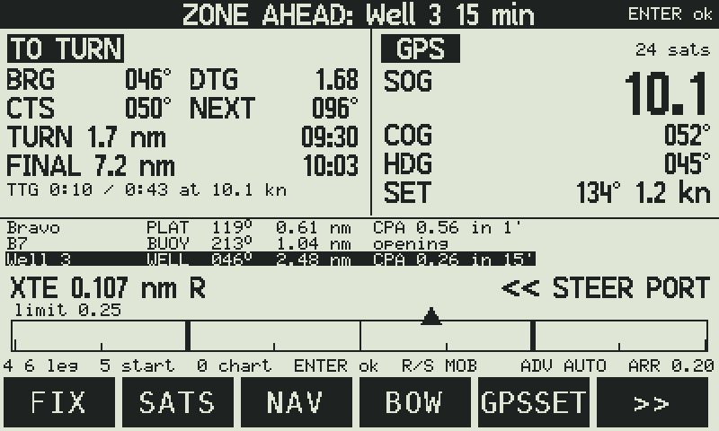

# NAV47 manuals

NAV47 is a navigation computer for the SwissMicros **DM42n** calculator, with a web page that runs the same program.
It joins three programs of the "47" family (Almanac 47, Tide 47, Zones 47) and adds passage planning, DP station
keeping, a GPS with route monitoring, and your own platforms and waypoints.

| Manual | For |
|---|---|
| [1. The calculator](01-calculator.md) | Install, the keys, every page: the almanac views, tides, the route and the plan, the chart and the voyage, the zones, the DP page, your files |
| [2. The GPS](02-gps.md) | The GPS pages, route monitoring, DR, alarms, MOB; **connecting the calculator to a GPS or the ship's NMEA line**, step by step |
| [3. The web page](03-web.md) | The same program in a browser: the Route tab with live monitoring, the GPS tab, the other tabs |
| [4. Formulas, accuracy and references](04-formulas.md) | How every number is computed, how accurate it is, and where the methods come from |

**Not for navigation.** NAV47 does not replace the Nautical Almanac, official tide tables, official charts or the
ship's navigation equipment. Use it to check and to plan; navigate with the official sources.

The pictures are made by `docs/manual/screens.sh` from the program itself: the calculator in the PC simulator, the web
page in Chrome. They use a made-up route, platforms and GPS track in the open Gulf; nothing in them is real data.

To make PDFs of these manuals: `make manual` (they go to `build/manual/`).
